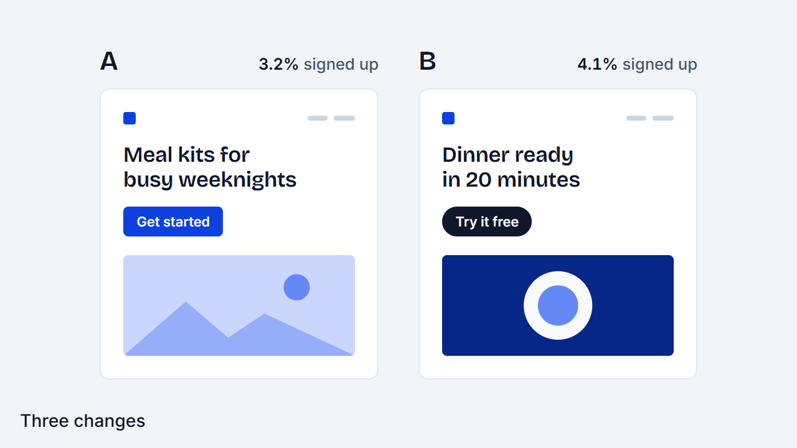
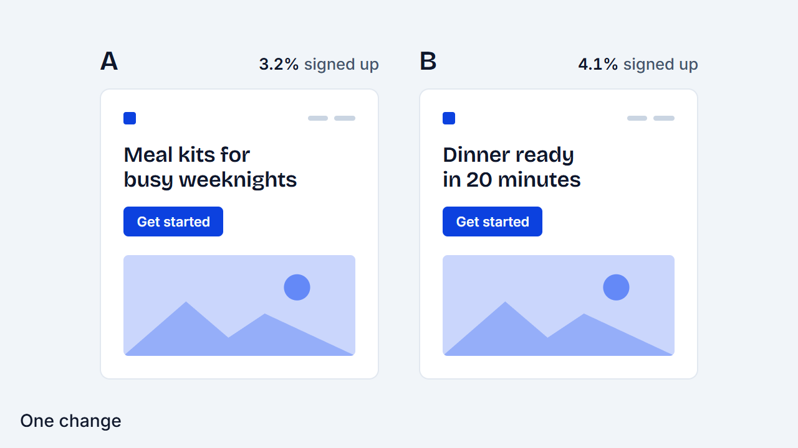

# A/B test one change at a time

An A/B test shows two versions of a page to different visitors and compares how each one performs. Version A is usually the current page, and version B has a change you think might work better. If B changes the headline, the image and the button all at once, the result can't tell you which change made the difference, or whether one change helped while another hurt. Test one meaningful change per experiment, keep the winner, then test the next change.

## Rule

Make version B identical to version A except for one meaningful change. Put every other idea in a later test that starts from the winning version.

## How to apply

1. Name the one change the test is about (for example, a new headline) and the goal it should move (for example, sign-ups).
2. Build B as a copy of the current page and change only that element. Keep the image, the button, the layout and the rest of the copy exactly as they are in A.
3. Run the test, then keep the winner as the new version A.
4. Start the next test from that winner, changing the next element (for example, the button).
5. Keep a list of planned tests in order, so new ideas wait their turn instead of joining the running test.

```yaml
# A test plan: each test changes one element of the current winner
- test: Homepage headline
  change: headline
  a: "Meal kits for busy weeknights"
  b: "Dinner ready in 20 minutes"
- test: Homepage button        # starts once the headline test has a winner
  change: button label
  a: "Get started"
  b: "Try it free"
```

## Check your work

- [ ] Comparing A and B side by side, exactly one element differs; everything else is identical.
- [ ] The test names that one change and one goal.
- [ ] Other ideas are queued as separate tests, not added to the running one.
- [ ] Each new test starts from the previous test's winner.

## When to break it

- When you want to know whether a full redesign beats the current page, test the two pages against each other. You'll learn which page wins, but not which part of it made the difference.
- One change can touch more than one element when they express one idea, like a new offer that needs both a new headline and a matching button label.

## Before and after

- **Three changes:** version B has a new headline, a new image and a new button. It gets more sign-ups (4.1% against 3.2%), but there's no way to tell which change did it.
- **One change:** version B differs from A only in its headline; the image and the button match. The same 4.1% against 3.2% now points to the headline.

| Three changes (`before.png`) | One change (`after.png`) |
| --- | --- |
|  |  |

## Files

- `before.png` and `after.png`: screenshots of the two states, **Three changes** and **One change**.
- `demo.html`: a self-contained page that shows the lesson working. Open it in a browser.
- `lesson.md`: the lesson as written on designspo.co, word for word.
