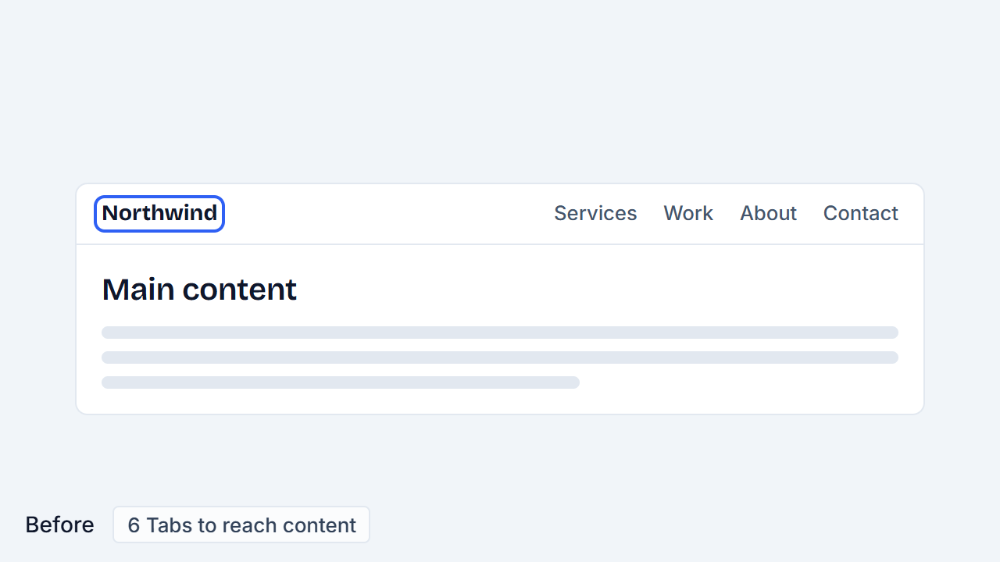
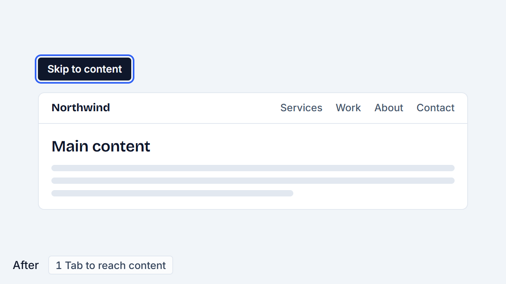

# Add a skip to content link for articles

People who use a keyboard move through a page by pressing Tab, one link at a time, so without a shortcut they have to press Tab past every link in the header, on every page, before they reach the main content. A "Skip to content" link fixes this: it's the first link on the page, hidden until someone presses Tab, and it jumps straight to the main content. It takes one link and a few lines of CSS, and it can save keyboard users dozens of key presses on every page.

## Rule

Make a "Skip to content" link the first focusable element on every page, linking to the main content. Hide it off-screen until it gets keyboard focus, then show it on top of the page.

## How to apply

1. Give the main content an `id`, usually on the `<main>` element. If the page has no `<main>`, wrap the main content in one.
2. Add the link as the very first element inside `<body>`, before the logo and navigation. Put it in the shared layout or page template, so every page gets it.
3. Move it off-screen until it's focused. Don't hide it with `display: none` or `visibility: hidden`, which take it out of the Tab order.

```html
<body>
  <a class="skip-link" href="#main">Skip to content</a>
  <header>...</header>
  <main id="main">...</main>
</body>
```

```css
.skip-link {
  position: absolute;
  top: 0.5rem;
  left: 0.5rem;
  z-index: 1000; /* above a sticky header */
  padding: 0.5rem 0.75rem;
  border-radius: 4px;
  background: #111;
  color: #fff;
  transform: translateY(-200%);
}

.skip-link:focus {
  transform: none;
}
```

## Check your work

- [ ] The skip link is the first focusable element in the page source, before the logo and header links.
- [ ] Its `href` matches the `id` of the main content, and that element exists on every page.
- [ ] It's hidden by moving it off-screen, not with `display: none` or `visibility: hidden`.
- [ ] On the first Tab, it appears at the top left, on top of the header, with readable text and a visible focus outline.
- [ ] After pressing Enter on it, the next Tab lands on the first link inside the main content, not in the header.

## When to break it

- If nothing focusable comes before the main content (no links in the header, or the content comes first in the source), there's nothing to skip, so leave it out.

## Before and after

- **Before:** a small website with a header of links above the main content. The first Tab focuses the logo, with every header link still to pass: 6 Tabs to reach the content.
- **After:** the first Tab shows a "Skip to content" link above the header: 1 Tab to reach the content.

| Before (`before.png`) | After (`after.png`) |
| --- | --- |
|  |  |

## Files

- `before.png` and `after.png`: screenshots of the two states, **Before** and **After**.
- `demo.html`: a self-contained page that shows the lesson working. Open it in a browser.
- `lesson.md`: the lesson as written on designspo.co, word for word.
