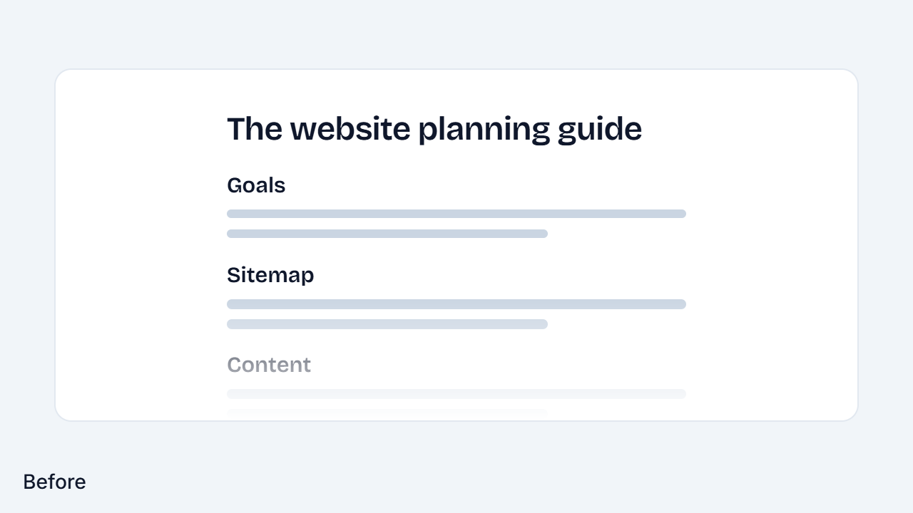
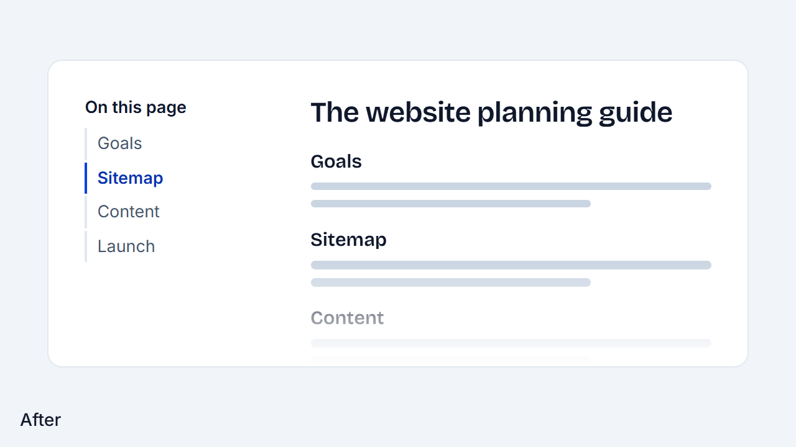

# Add a table of contents to long pages

Long pages, like guides, documentation and policies, are hard to move around by scrolling alone. Readers often need to find one specific part, and they don't know how far down it is. A table of contents fixes this: a link to each main section, at the top of the page or in a column that stays in view at the side on wide screens, so readers can jump straight to what they're looking for.

## Rule

On long pages, add a table of contents with a link to each main section. Put it at the top of the page, or keep it in view at the side on wide screens.

## How to apply

1. Give each main section heading (usually each `h2`) a short, unique `id`.
2. Add a `<nav>` with a list of links to those ids, in the same order and with the same words as the headings. If you can, generate it from the headings in the page template, so it stays in sync when sections change.
3. Place it before the article. On narrow screens it sits at the top; on wide screens, move it into a side column and make it sticky.
4. If the site has a sticky header, give the headings a `scroll-margin-top` (for example `h2[id] { scroll-margin-top: 5rem; }`), so a heading you jump to isn't hidden under it.
5. Optionally, highlight the link for the section in view. That needs a small script, such as an IntersectionObserver that sets `aria-current="true"` on the link.

```html
<div class="page">
  <nav class="toc" aria-label="On this page">
    <ol>
      <li><a href="#goals">Goals</a></li>
      <li><a href="#sitemap">Sitemap</a></li>
      <li><a href="#launch">Launch</a></li>
    </ol>
  </nav>
  <article>
    <h2 id="goals">Goals</h2>
    ...
  </article>
</div>
```

```css
.page {
  display: grid;
  gap: 2rem;
}

/* Wide screens: a side column that stays in view */
@media (min-width: 64rem) {
  .page {
    grid-template-columns: 14rem minmax(0, 1fr);
    align-items: start; /* without this, the column stretches and can't stick */
  }

  .toc {
    position: sticky;
    top: 2rem;
  }
}
```

## Check your work

- [ ] Every main section heading has a unique `id`, and every link points to an id that exists.
- [ ] The links follow the same order and wording as the headings.
- [ ] The table of contents is a `<nav>` with an accessible name, containing a list of links.
- [ ] On wide screens it stays in view while scrolling; on narrow screens it sits above the article without covering any text.
- [ ] After jumping to a section, its heading is fully visible, not hidden under a sticky header.

## When to break it

- Short pages that fit on a screen or two, or have only two or three sections, don't need one.
- Sales and landing pages, which are meant to be read from top to bottom, usually work better without one.

## Before and after

- **Before:** a long guide page, "The website planning guide", with the article alone in the middle of the page and no way to jump to a section.
- **After:** the article glides to the right and a table of contents fades in on the left, listing Goals, Sitemap, Content and Launch, with Sitemap highlighted as the current section.

| Before (`before.png`) | After (`after.png`) |
| --- | --- |
|  |  |

## Files

- `before.png` and `after.png`: screenshots of the two states, **Before** and **After**.
- `demo.html`: a self-contained page that shows the lesson working. Open it in a browser.
- `lesson.md`: the lesson as written on designspo.co, word for word.
