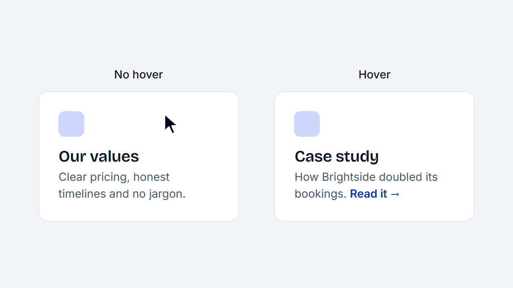
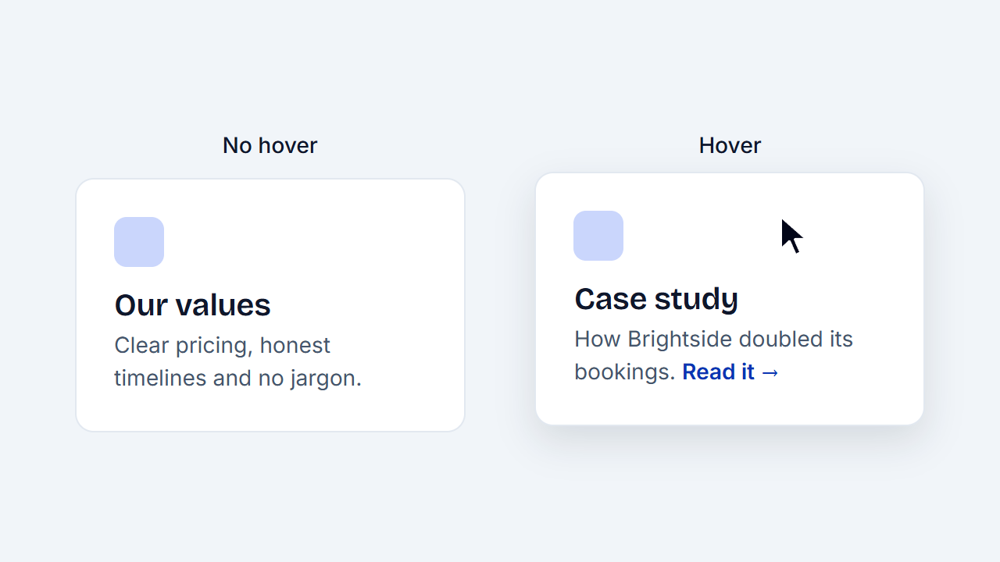

# Add hover states only to things you can click

People read a hover effect as a promise that an element is clickable: years of using the web have taught them that when a card lifts or changes color under the cursor, it links somewhere. Put that effect on a card or image that doesn't link anywhere, and people click, nothing happens, and they wonder if the site is broken.

## Rule

Only give hover styles (lift, shadow, color change, `cursor: pointer`) to links, buttons and other elements that do something. When a card has a hover effect, make the whole card clickable.

## How to apply

1. Find every element with a `:hover` style or `cursor: pointer`.
2. For each one, check that it's a link, a button or another interactive control. If it isn't, remove its hover style and pointer cursor.
3. For cards that do link somewhere, stretch the link over the whole card, so the hover area and the click area are the same.

```css
/* Cards that only show information don't react to the cursor */
.card {
  position: relative;
  transition: transform 150ms ease, box-shadow 150ms ease;
}

/* Cards that link somewhere react, and the whole card is clickable */
.card:has(.card__link):hover {
  transform: translateY(-4px);
  box-shadow: 0 10px 24px rgb(0 0 0 / 0.12);
}

.card__link::after {
  content: "";
  position: absolute;
  inset: 0;
}
```

## Check your work

- [ ] Every element with a hover style or `cursor: pointer` is a link, a button or a form control.
- [ ] Cards with a hover effect can be clicked anywhere, not only on a small link inside them.
- [ ] Nothing that is purely informational lifts, darkens or changes the cursor on hover.

## When to break it

- Text reveals and info popups can open on hover, but they should usually also open on click (to lock them in place) and on keyboard focus.

## Before and after

- **No hover:** an "Our values" card that only shows information stays still under the cursor.
- **Hover:** a "Case study" card that links to a story lifts, with a soft shadow, when the cursor moves onto it.

| No hover (`before.png`) | Hover (`after.png`) |
| --- | --- |
|  |  |

## Seen on

- [George Wert](https://georgewert.com): the homepage hero, where the Book Appointment and See Portfolio buttons are the clickable elements.

## Files

- `before.png` and `after.png`: screenshots of the two states, **No hover** and **Hover**.
- `demo.html`: a self-contained page that shows the lesson working. Open it in a browser.
- `lesson.md`: the lesson as written on designspo.co, word for word.
