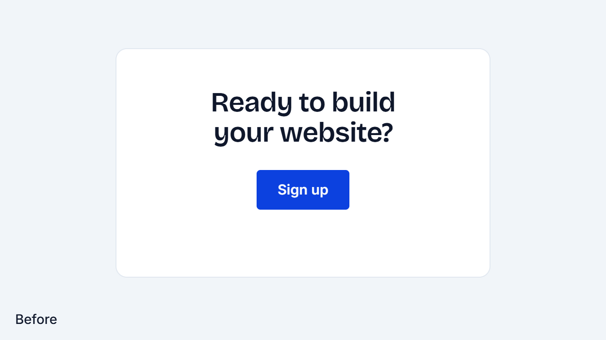
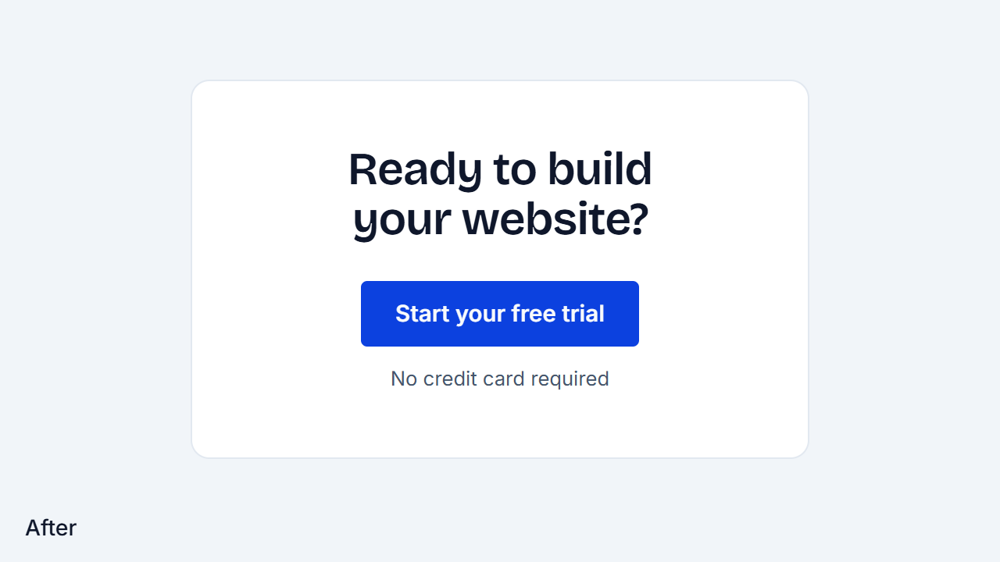

# Add reassurance to your CTA

Right before they click, people often hesitate, especially when the button is vague. A "Sign up" button doesn't say whether they'll be charged, whether they can cancel or whether they'll start getting spam. A button label that says what happens, plus a short line of reassurance under it, answers that worry at the exact moment it comes up, without competing with the button.

## Rule

Label the main button with what happens when it's clicked, and under it add one line of small, muted text that answers the biggest worry about clicking it, like "No credit card required" under "Start your free trial". Only promise what's true.

## How to apply

1. Ask what might stop someone clicking this button: being charged, not being able to cancel, getting spam.
2. If the label is vague, like "Sign up" or "Submit", rewrite it to say what happens, like "Start your free trial".
3. Write one short line that answers the most likely worry, like "No credit card required" for a free trial, "Cancel anytime" for a subscription or "No spam, unsubscribe anytime" for a newsletter. Make sure it's true for this site; if you can't confirm it, ask the site owner rather than guess.
4. Place it directly under the button, aligned the same way, in smaller and lighter text than the button label. If the button lives in a shared component, add the line there as optional text, since the right promise changes from button to button.
5. Connect it to the button with `aria-describedby`, so screen reader users hear it when they reach the button.

```html
<a class="button" href="/signup" aria-describedby="trial-note">Start your free trial</a>
<p class="reassurance" id="trial-note">No credit card required</p>
```

```css
.reassurance {
  margin: 0.75rem 0 0;
  font-size: 0.8125rem;
  line-height: 1.4;
  color: #45556c; /* muted, but still well above 4.5:1 contrast on white */
}
```

## Check your work

- [ ] The button label says what happens when it's clicked, not just "Sign up" or "Submit".
- [ ] One line of reassurance sits directly under the main button, with a small gap, aligned with it.
- [ ] It stays on one line, even on a phone-width screen.
- [ ] Its text is smaller and lighter than the button label, but still has at least 4.5:1 contrast with its background.
- [ ] It answers a real worry about clicking, and its promise matches how the site actually works.

## When to break it

- If there's no true, specific promise to make, leave it out: a broken promise at this stage can cost more trust than it gains.
- Buttons with nothing at stake, like "Read more" or "See pricing", don't need one.

## Before and after

- **Before:** a call-to-action card reading "Ready to build your website?" with a bare "Sign up" button, so people have to guess whether they'll be charged.
- **After:** the button says "Start your free trial", and a small line under it reads "No credit card required".

| Before (`before.png`) | After (`after.png`) |
| --- | --- |
|  |  |

## Files

- `before.png` and `after.png`: screenshots of the two states, **Before** and **After**.
- `demo.html`: a self-contained page that shows the lesson working. Open it in a browser.
- `lesson.md`: the lesson as written on designspo.co, word for word.
