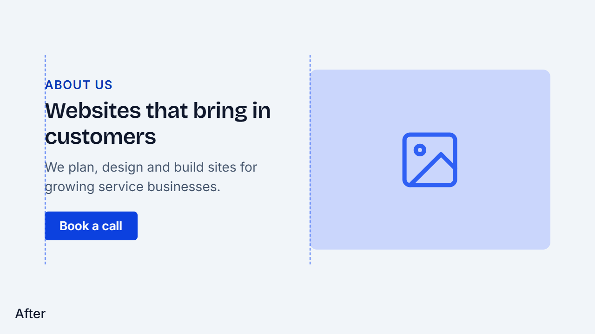

# Align elements to edges

When visitors look at a section, their eyes follow invisible lines along the edges of things: where a heading starts, where a paragraph starts, where an image begins. Every element that starts in a new place adds one more line to follow, and too many can make a section look busy, even when each piece is well designed on its own. Pick two or three edges and line everything up on them.

## Rule

Line up every element in a section on two or three shared edges. Remove any margin, padding or text alignment that gives an element a starting edge of its own.

## How to apply

1. In each section, note where each element starts, such as the heading, paragraph, button and image. A screenshot with vertical guide lines makes small differences easy to spot.
2. Pick the edges. In a split section, the heading, paragraph and button start on the text column's left edge, and the image starts on a second edge, where its column begins.
3. Delete whatever pushes an element off its edge: a stray `margin-left` or `padding-left`, `text-align: center` on one paragraph in a left-aligned column, `margin: 0 auto` on a narrowed paragraph, extra margin around an image. Fix it where it's set, in the component or a utility class, instead of adding overrides.
4. Let the layout's columns and gap decide where each edge is, rather than offsets on single elements.

```css
/* Two edges: the text column starts on one, the image column on the other */
.split {
  display: grid;
  grid-template-columns: 1fr 1fr;
  gap: 2rem;
  align-items: center;
}

/* Then delete anything that moves an element off its edge, such as:
   .split h2      { padding-left: 1.25rem; }
   .split p       { text-align: center; }
   .split .button { margin-left: 2.5rem; }
   .split img     { margin: 1.5rem 0 0 1.5rem; } */
```

## Check your work

- [ ] On a screenshot, a vertical line at each element's starting edge gives two or three lines per section, not one per element.
- [ ] The heading, paragraph and button in a text column start at the same x position (compare their `getBoundingClientRect().left`).
- [ ] No paragraph or heading is centered inside a left-aligned column.
- [ ] No element has a one-off left margin or padding that moves it off its column's edge.

## When to break it

- Fully centered sections, like a short call to action, line up on one center line instead. Keep everything in them centered.
- Small optical nudges, like hanging a quotation mark just outside the text edge, can make text look better aligned.

## Before and after

- **Before:** a split section with text on the left and an image on the right, with dashed guide lines at each starting edge. The heading, paragraph, button and image each start in a different place: the heading is indented, the paragraph is centered, the button is pushed in further and the image is pushed down and to the right.
- **After:** the text shares one left edge and the image a second, so only two guide lines remain.

| Before (`before.png`) | After (`after.png`) |
| --- | --- |
|  |  |

## Files

- `before.png` and `after.png`: screenshots of the two states, **Before** and **After**.
- `demo.html`: a self-contained page that shows the lesson working. Open it in a browser.
- `lesson.md`: the lesson as written on designspo.co, word for word.
