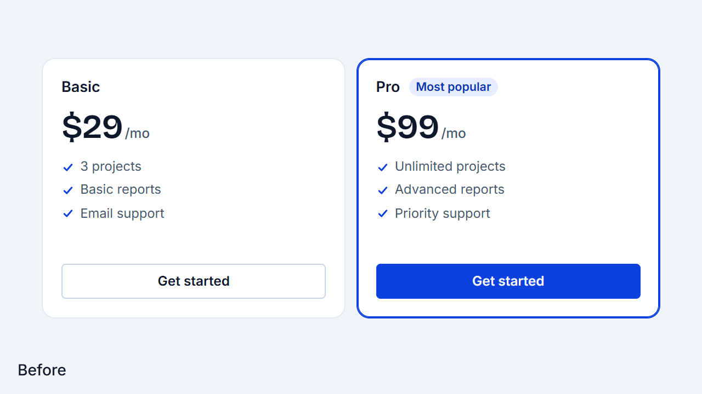
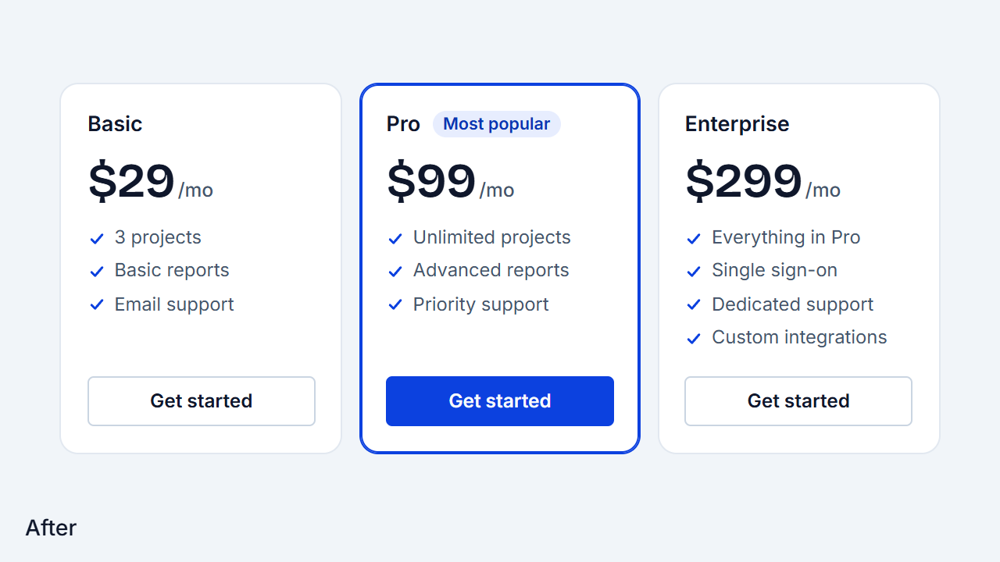

# Anchor your price with a higher plan

People rarely judge a price on its own; they compare it with whatever is nearby. A $99 plan can feel pricey when it's the most expensive thing on the page, but reasonable next to a $299 plan. This is anchoring: a higher-priced plan beside your main plan makes the main one look like the sensible choice. It only works when the higher plan has significantly more to offer, because a plan that exists only to make the others look cheap is easy to spot, and it can hurt trust in the rest of your pricing.

## Rule

Place a higher-priced plan next to the plan you most want people to choose, and give it substantial extras that some customers genuinely need. Never add a plan that nobody is meant to buy.

## How to apply

1. Identify the main plan, the one most customers should choose, and mark it, for example with a "Most popular" badge and the filled button.
2. Put a higher tier beside it, usually to its right in ascending order: Basic, Pro, Enterprise.
3. Give the higher tier real extras that matter to bigger customers. For software these are often company-wide single sign-on, a dedicated account rep and custom integrations, on top of everything in the main plan.
4. Keep the main plan complete for its audience, like solo founders and power users who find the basic plan too limiting, so it doesn't feel stripped down next to the top tier.
5. Show every price at the same size and in the same format, so the comparison is instant.
6. Only list a tier the business actually sells and can deliver. If there isn't one, flag it to the site owner rather than inventing one.

```html
<div class="plans">
  <article class="plan">…Basic, $29/mo…</article>
  <article class="plan plan--featured">…Pro, $99/mo, Most popular…</article>
  <article class="plan">
    <h3>Enterprise</h3>
    <p class="price">$299<span>/mo</span></p>
    <ul>
      <li>Everything in Pro</li>
      <li>Single sign-on</li>
      <li>Dedicated support</li>
      <li>Custom integrations</li>
    </ul>
    <a class="button" href="/signup?plan=enterprise">Get started</a>
  </article>
</div>
```

```css
.plans {
  display: grid;
  grid-template-columns: repeat(auto-fit, minmax(14rem, 1fr));
  gap: 12px;
}

/* The main plan stands out; the higher plan is a normal card beside it */
.plan--featured { outline: 2px solid currentColor; }
```

## Check your work

- [ ] The main plan sits next to at least one higher-priced plan and isn't the most expensive plan on the page.
- [ ] The higher plan lists substantial extras beyond the main plan, not the same features reworded or just a bigger number.
- [ ] The higher plan can actually be bought: its button leads to a real signup or sales flow.
- [ ] The main plan is still the most visually prominent card, and all prices use the same format.

## When to break it

- If the business sells one product at one price, don't invent tiers to create an anchor.
- If a higher tier would exist only to make the others look cheap, leave it out: people can often tell, and it may hurt their trust in the rest of your pricing.

## Before and after

- **Before:** a pricing table where Basic at $29 and Pro at $99, highlighted as the main plan, fill the whole row. Pro is the most expensive plan on the page.
- **After:** Basic and Pro shrink and slide left to make room for an Enterprise plan at $299, with everything in Pro plus single sign-on, dedicated support and custom integrations. Pro still stands out, and now looks like the sensible choice.

| Before (`before.png`) | After (`after.png`) |
| --- | --- |
|  |  |

## Files

- `before.png` and `after.png`: screenshots of the two states, **Before** and **After**.
- `demo.html`: a self-contained page that shows the lesson working. Open it in a browser.
- `lesson.md`: the lesson as written on designspo.co, word for word.
