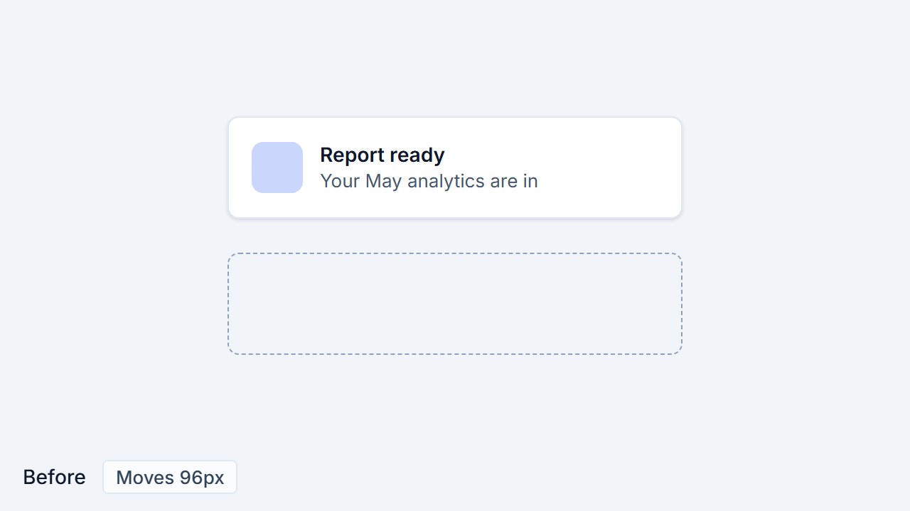
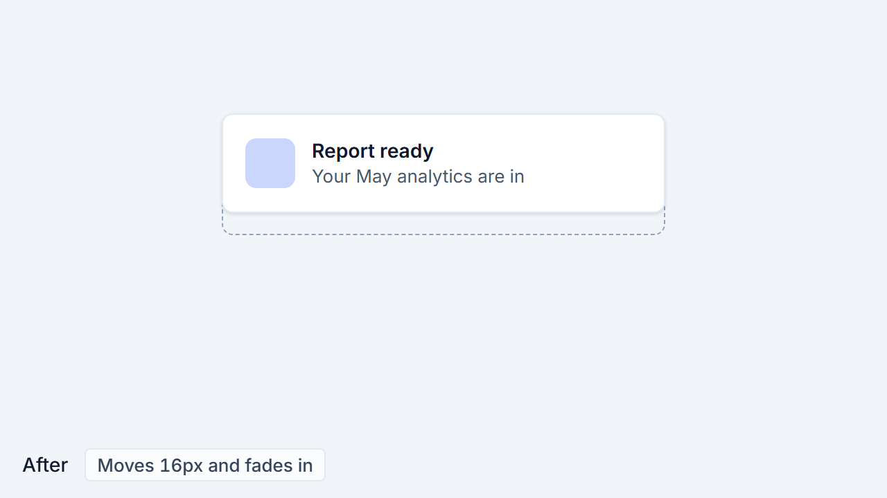

# Animate elements using short distances

When an element slides in from far away, like a card flying up from the bottom of the screen, people have to watch it travel before they can use it. Long movements take more time, and they can pull attention away from whatever the person was doing. Keep the movement small and pair it with a fade: the short shift still hints at where the element came from, and the fade does most of the work of drawing the eye.

## Rule

Start an entrance animation about 8 to 24px from where the element ends up, and fade it in as it moves. For example, move a card up 16px while it fades from transparent to fully visible.

## How to apply

1. Find entrance animations: `@keyframes`, transitions on `transform` or `translate`, and `y` values in animation libraries.
2. Reduce any starting offset above 24px to between 8 and 24px, including off-screen starts like `100%` or `100vh`. 16px is a good default.
3. Fade `opacity` from 0 to 1 over the same duration as the move.
4. Define the animation once in your global styles and reuse it for every element that enters.
5. For people who ask for reduced motion, keep the fade and drop the move.

```css
/* translate, not transform, so it combines with any transform the element already has */
@keyframes fade-up {
  from {
    opacity: 0;
    translate: 0 16px;
  }
}

@keyframes fade-in {
  from { opacity: 0; }
}

.notification {
  animation: fade-up 300ms ease-in-out backwards;
}

@media (prefers-reduced-motion: reduce) {
  .notification { animation-name: fade-in; }
}
```

## Check your work

- [ ] No entrance animation starts more than about 24px from where the element ends up, and none starts off-screen.
- [ ] Every entrance that moves also fades in from `opacity: 0`.
- [ ] Under `prefers-reduced-motion: reduce`, elements fade in without moving.

## When to break it

- Drawers and side panels that stay attached to an edge of the screen can slide in from that edge, since the movement shows where they live.
- Elements that follow a finger or cursor, like a card being dragged or swiped, move as far as the pointer does.

## Before and after

- **Before:** a notification card slides up 96px into place over 700ms, with no fade. A dashed outline marks where it starts.
- **After:** the outline sits just 16px below the card, and the card moves up only that far while it fades in, over 300ms.

| Before (`before.png`) | After (`after.png`) |
| --- | --- |
|  |  |

## Files

- `before.png` and `after.png`: screenshots of the two states, **Before** and **After**.
- `demo.html`: a self-contained page that shows the lesson working. Open it in a browser.
- `lesson.md`: the lesson as written on designspo.co, word for word.
