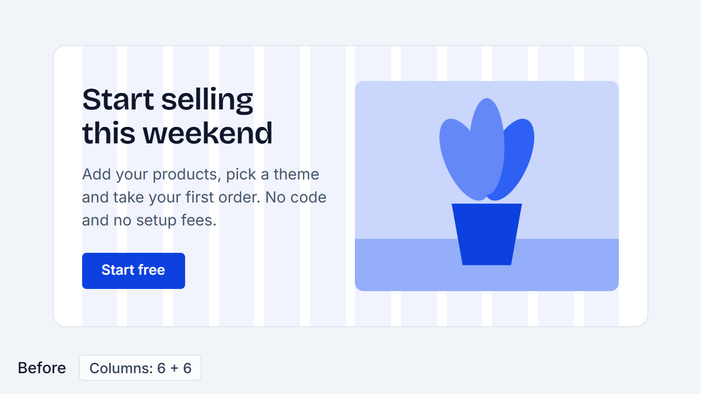
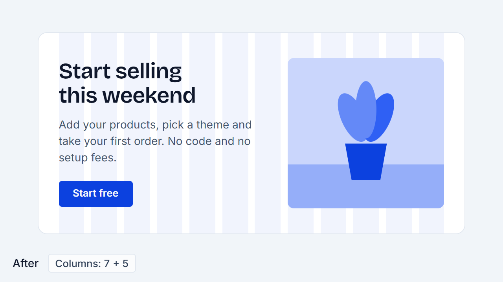

# Asymmetric grid layouts

Marketing pages often use a two-column section with text on one side and an image on the other, and designers tend to default to a 50/50 split, which can feel a bit generic. An uneven split, like seven columns of twelve for the text and five for the image, shows visitors which side matters more. Building it on a 12-column grid keeps both sides related to each other and to the rest of the page, since 12 divides cleanly into halves, thirds and quarters and also allows splits like 7-5 or 8-4.

## Rule

Lay out split sections on a shared 12-column grid and give the more important side more columns, such as text 7 and image 5, instead of defaulting to 6 and 6.

## How to apply

1. Decide which side of each split section matters more. Usually it's the text: the message and the call to action.
2. Define one 12-column grid with a fixed gutter, and use it for every section so edges line up down the page.
3. Span the important side over 7 or 8 columns and the other side over 5 or 4.
4. Stack the two sides on phones, where there's no room for a split.

```css
.split {
  display: grid;
  grid-template-columns: repeat(12, minmax(0, 1fr));
  column-gap: 24px;
  align-items: center;
}

.split__text { grid-column: 1 / span 7; }
.split__media { grid-column: 8 / span 5; }

@media (max-width: 767px) {
  .split__text,
  .split__media { grid-column: 1 / -1; }
}
```

## Check your work

- [ ] Split sections are placed on the shared 12-column grid, not on ad hoc widths or percentages.
- [ ] The two spans add up to 12 (like 7 + 5 or 8 + 4), and the wider one holds the more important content.
- [ ] The column edges line up with the other sections on the page.

## When to break it

- When both sides really are equally important, like two options compared side by side, a 6 + 6 split is the honest choice.
- On phones the columns stack, so the split only applies from tablet width up.

## Before and after

- **Before:** a split section with the heading "Start selling this weekend", a paragraph and a button beside a product photo, each side taking 6 of the 12 columns.
- **After:** the text takes 7 columns and the photo 5.

| Before (`before.png`) | After (`after.png`) |
| --- | --- |
|  |  |

## Files

- `before.png` and `after.png`: screenshots of the two states, **Before** and **After**.
- `demo.html`: a self-contained page that shows the lesson working. Open it in a browser.
- `lesson.md`: the lesson as written on designspo.co, word for word.
