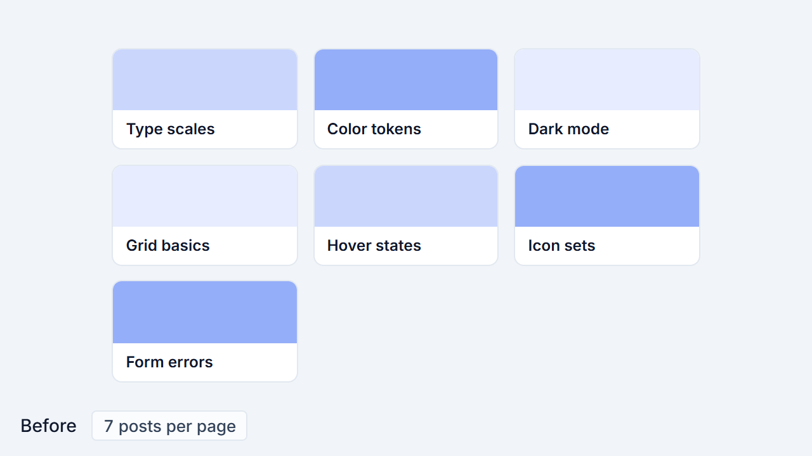
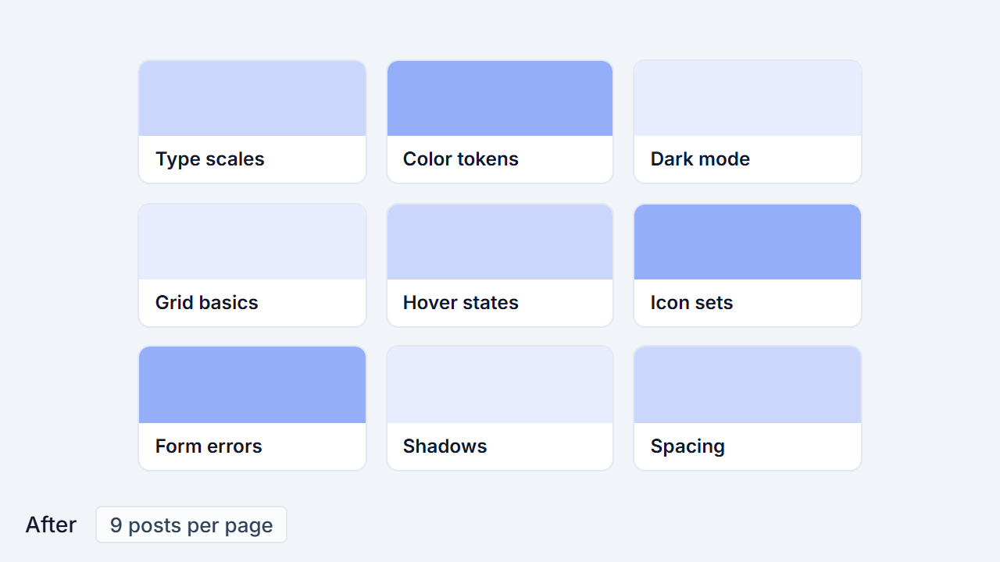

# Reorganize lonely cards

Grids look best when every row is full. Seven cards in a three-column grid leave one card alone on the last row: it adds extra space at the end of the section, and it can make the grid look unfinished, as if something failed to load. Plan the item count around the column count, and for grids that change often, pick a page size that divides evenly.

## Rule

Make the number of items in a grid a multiple of its column count. For content that doesn't change, change the number of columns, add or remove an item, or center the cards in the last row. For paginated lists, use a posts-per-page number that divides evenly by the columns.

## How to apply

1. Find every card grid and note its column count at each breakpoint (from `grid-template-columns` or the number of items per row).
2. For content that doesn't change (features, services, team members), count the items. If the count doesn't divide evenly by the columns, change the number of columns, add or remove an item, or center the last row.
3. For grids that change often, like a blog archive, set posts per page to a multiple of the column count, like 6, 9 or 12 for three columns, and split the rest across numbered pages. In a CMS this is usually a setting, like "Blog pages show at most" in WordPress.
4. Check every breakpoint, not just desktop: 9 fills three columns but leaves one card alone in two columns, while 12 divides evenly by 2, 3, 4 and 6.

```css
/* For fixed content you can't change: center whatever lands in the last row */
.cards {
  display: flex;
  flex-wrap: wrap;
  justify-content: center;
  gap: 24px;
}

.cards > * {
  flex: 0 0 calc((100% - 2 * 24px) / 3); /* three columns */
}
```

## Check your work

- [ ] Every fixed grid's item count divides evenly by its column count, or its last row is centered on purpose.
- [ ] Paginated grids use a page size that's a multiple of the column count at each breakpoint (6, 9 or 12 for three columns).
- [ ] Screenshots at desktop, tablet and phone widths show no single card alone on the last row.

## When to break it

- Infinite scrolling: a partly filled last row is often impossible to avoid there, and it doesn't read as less clean.
- The last page of a paginated archive will often be partly filled. Only the regular pages need full rows.

## Before and after

- **Before:** a blog archive showing 7 posts per page on a three-column grid, so the seventh card sits alone on the last row.
- **After:** 9 posts per page, so all three rows are full.

| Before (`before.png`) | After (`after.png`) |
| --- | --- |
|  |  |

## Files

- `before.png` and `after.png`: screenshots of the two states, **Before** and **After**.
- `demo.html`: a self-contained page that shows the lesson working. Open it in a browser.
- `lesson.md`: the lesson as written on designspo.co, word for word.
