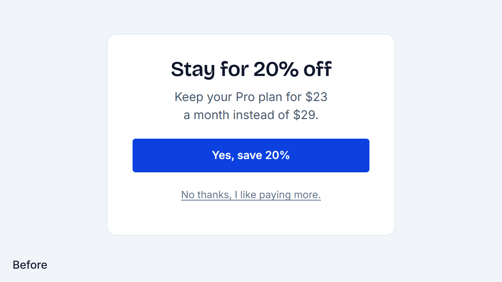
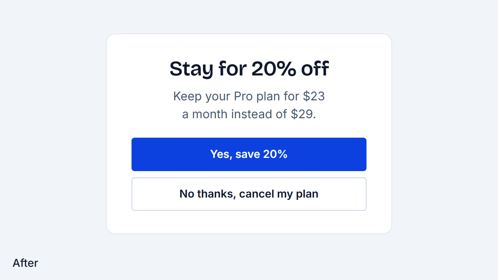

# Avoid dark patterns

"Dark patterns" are design tricks that lead people to do things they otherwise wouldn't do. Common examples are pre-checked add-ons at checkout, cancel links that are hard to find, and "no thanks" links that shame people for declining, like "No thanks, I like paying more." They may lift a number for a while, but the cost usually shows up later, in refunds, complaints, cancellations and lost trust.

## Rule

Make every choice honest and easy to decline: nothing that costs money is selected by default, every way out is easy to find, and decline options use plain, neutral words. If you'd feel uncomfortable explaining a section to a prospect in person, change it.

## How to apply

1. Search checkout, signup and upsell forms for checkboxes, toggles or radio buttons that add an extra cost, a subscription or consent, and make them unselected by default.
2. Find every way out: cancel, unsubscribe, close and decline. Make each one visible and readable, as a secondary button or a normal-size link with proper contrast, not tiny, faint text. Cancelling should take no more steps than signing up.
3. Rewrite decline copy in neutral words, like "No thanks" or "No thanks, cancel my plan". Remove guilt, mockery and confusing double negatives.
4. Read each offer, popup and checkout as if you were explaining it to a prospect face to face. Change anything you'd hesitate to say out loud.

```html
<div class="offer-actions">
  <button class="button" type="button">Yes, save 20%</button>
  <button class="button button--secondary" type="button">No thanks, cancel my plan</button>
</div>

<!-- Paid extras start unchecked -->
<label><input type="checkbox" name="priority-support"> Add priority support (+$9 a month)</label>
```

```css
.offer-actions {
  display: grid;
  gap: 0.5rem;
}

/* The way out is a real button: visible, readable, neutral */
.button--secondary {
  border: 1px solid #CAD5E2;
  background: #FFFFFF;
  color: inherit;
}
```

## Check your work

- [ ] No checkbox, toggle or radio button that adds a cost, a subscription or marketing consent is selected by default.
- [ ] Cancel, unsubscribe and decline options are visible without scrolling or hunting, at least the size of body text, with at least 4.5:1 contrast.
- [ ] No decline option uses guilt or shame, like "No thanks, I like paying more".
- [ ] Declining or cancelling takes no more steps than accepting or signing up.

## When to break it

- A default is fine when it costs nothing and is what nearly everyone wants, like free standard shipping.
- A retention offer before cancelling is fine, as long as the option to cancel sits right beside it in plain words.

## Before and after

- **Before:** an offer shown to someone cancelling their plan, "Stay for 20% off", where the only way out is a tiny, faint link that reads "No thanks, I like paying more."
- **After:** the same offer, with a clear outlined button under "Yes, save 20%" that reads "No thanks, cancel my plan".

| Before (`before.png`) | After (`after.png`) |
| --- | --- |
|  |  |

## Files

- `before.png` and `after.png`: screenshots of the two states, **Before** and **After**.
- `demo.html`: a self-contained page that shows the lesson working. Open it in a browser.
- `lesson.md`: the lesson as written on designspo.co, word for word.
