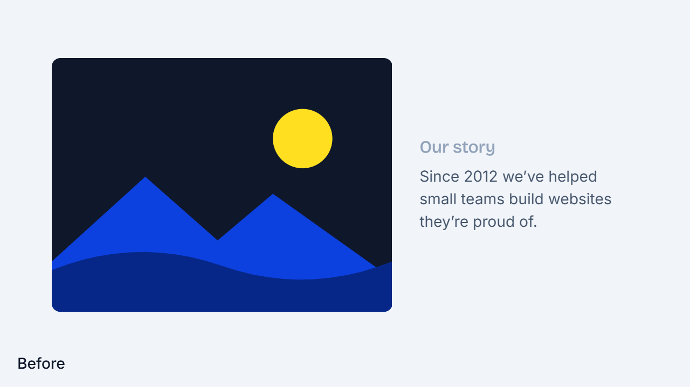
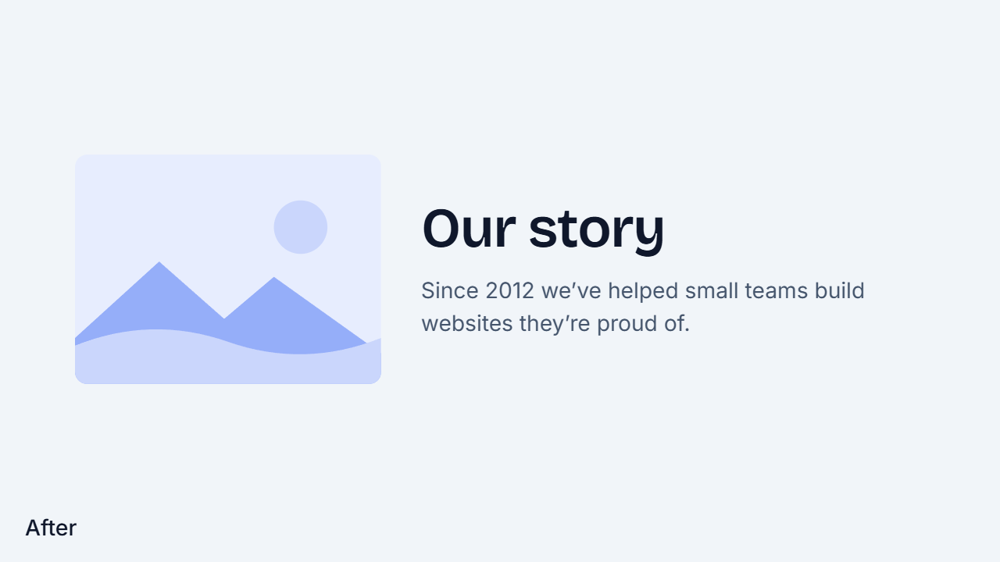

# Balancing images and text

Images carry a lot of visual weight: a large, high-contrast image pulls the eye even when it's only decoration. Next to a small, light headline, the image overpowers it, and visitors may miss the message entirely. Decide which one should lead before you place them together, and make the other one step back.

## Rule

Before you place an image and a headline together, decide which one should lead. If it's the headline, make the image smaller, lighter or lower in contrast, and give the headline more size and weight.

## How to apply

1. Find each place where an image sits next to a headline: heroes, image and text sections, cards.
2. Decide which should lead. If the image is decoration and the message matters more, the headline leads.
3. Give the image a smaller share of the layout, and use a lighter or lower-contrast image, or soften the one you have.
4. Make the headline larger, heavier and darker, so it stands out from the text around it.
5. Make these changes in the section or card component: its column sizes set how much room the image gets, and its heading styles set the headline.

```css
/* The headline leads: the image gets about a third of the row */
.feature {
  display: grid;
  grid-template-columns: 1fr 2fr;
  gap: 2rem;
  align-items: center;
}

/* Lighter and lower in contrast. Choosing a lighter image is even better. */
.feature img {
  width: 100%;
  height: auto;
  filter: brightness(1.1) contrast(0.85);
}

.feature h2 {
  font-size: clamp(1.75rem, 4vw, 2.5rem);
  font-weight: 600;
  color: #111;
}
```

## Check your work

- [ ] For each image and headline pair, you can say which one leads, and in a screenshot it's the first thing you notice.
- [ ] Where the headline leads, it's larger, bolder and darker than the text around it, not small or pale gray.
- [ ] Where the headline leads, the image is smaller, lighter or lower in contrast, for example narrower than the text column.
- [ ] Where the image leads, the text beside it is short.

## When to break it

- When the image is the point, like a product photo, let it lead: keep it large and keep the text beside it short.

## Before and after

- **Before:** a large, dark, high-contrast image fills more than half the card and overpowers a small, pale gray "Our story" headline.
- **After:** a smaller, lighter image takes about a third of the width, and the headline is large, bold and dark, so it leads.

| Before (`before.png`) | After (`after.png`) |
| --- | --- |
|  |  |

## Files

- `before.png` and `after.png`: screenshots of the two states, **Before** and **After**.
- `demo.html`: a self-contained page that shows the lesson working. Open it in a browser.
- `lesson.md`: the lesson as written on designspo.co, word for word.
