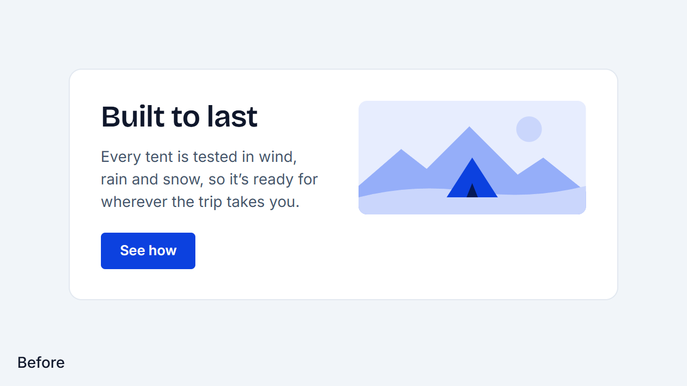
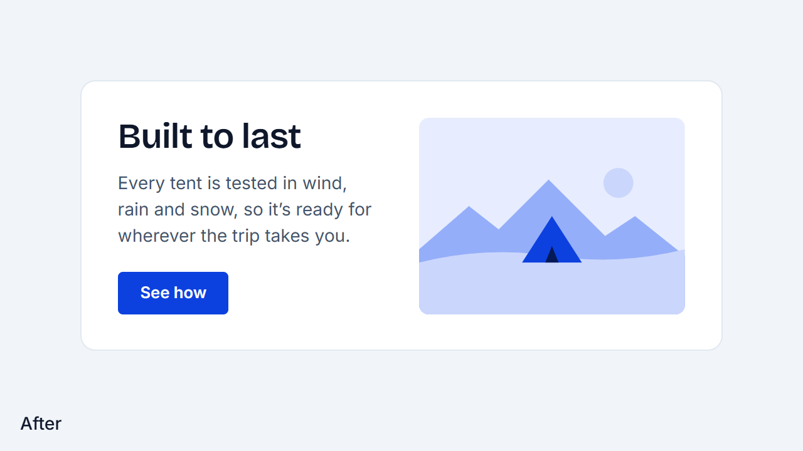

# Balancing imagery in two-column layouts

A split section puts text on one side and an image on the other. It's one of the most common layouts on the web, and easy to get wrong: when the image is small next to a tall block of text, or the two sides sit at different heights, the section feels lopsided. Center both sides vertically, so the middle of the text lines up with the middle of the image, and size the image so it's about as tall as the text. When both columns carry similar weight, the eye moves between them easily.

## Rule

In a two-column text and image section, align both columns to the vertical center and make the image about as tall as the text beside it.

## How to apply

1. Find split sections: two-column layouts with text (heading, paragraph, button) on one side and an image on the other.
2. Align the columns to the center (`align-items: center` on the grid or flex container), not to the top.
3. Size the image to the text: wrap it in an element that stretches to the row's height, and let the image fill that wrapper with `object-fit: cover`. The wrapper has no height of its own, so the text sets the height.
4. Give the wrapper a minimum height, so a short text block doesn't squash the image, and an aspect ratio when the columns stack on phones.

```css
.split {
  display: grid;
  grid-template-columns: 1fr 1fr;
  gap: 48px;
  align-items: center; /* the middles of both sides line up */
}

/* The wrapper stretches to the height of the text; the image crops to fill it */
.split__media {
  position: relative;
  align-self: stretch;
  min-height: 240px;
}

.split__media img {
  position: absolute;
  inset: 0;
  width: 100%;
  height: 100%;
  object-fit: cover;
}
```

## Check your work

- [ ] Split sections center their columns vertically instead of aligning them to the top.
- [ ] At desktop width, the image is about as tall as the text column, with no large empty gap under either side.
- [ ] The important part of each image survives the crop (adjust `object-position` if not).

## When to break it

- Very long text, like an article intro: pin the image to the top and keep it in view with `position: sticky` instead of stretching it.
- Images that mustn't be cropped, like product shots or diagrams: keep their aspect ratio and center them, and adjust the text length instead.

## Before and after

- **Before:** a "Built to last" section with a heading, a paragraph and a See how button beside a short photo pinned to the top, leaving empty space beneath it.
- **After:** the photo is as tall as the text and both sides are centered, so their middles line up.

| Before (`before.png`) | After (`after.png`) |
| --- | --- |
|  |  |

## Files

- `before.png` and `after.png`: screenshots of the two states, **Before** and **After**.
- `demo.html`: a self-contained page that shows the lesson working. Open it in a browser.
- `lesson.md`: the lesson as written on designspo.co, word for word.
