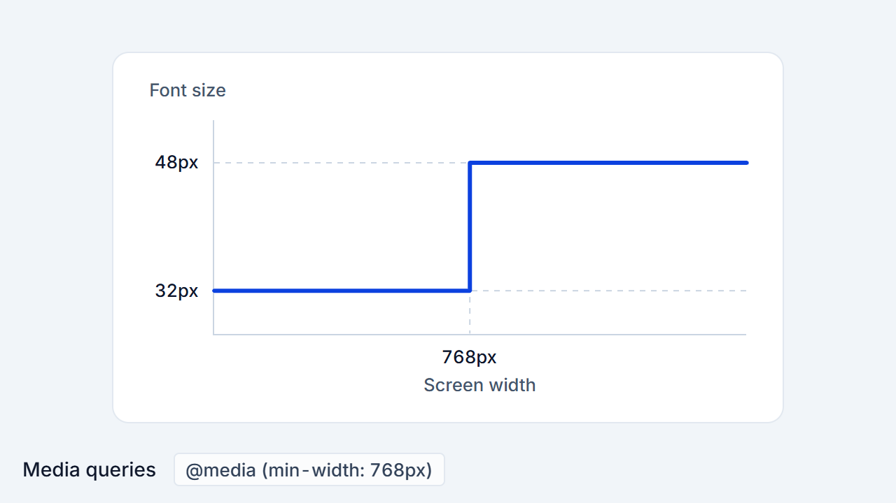

# Build a fluid type scale with clamp()

Most sites change font sizes at a few fixed screen widths with media queries, so a heading might jump from 32px to 48px the moment the screen crosses a breakpoint. That's a perfectly fine way to build a basic type system. A fluid type scale works differently: the CSS function `clamp()` takes a minimum size, a preferred size tied to the screen width (the `vw` unit, where 1vw is 1% of the screen width) and a maximum size, so text grows a little at a time and looks right at every width in between. It needs fewer styles, but it produces odd sizes like 33.4px.

## Rule

Define each step of the type scale as `clamp(minimum, rem + vw, maximum)` in a variable, and use those variables for every heading instead of media queries that change font sizes.

## How to apply

1. For each step, choose the smallest size, the largest size, and the screen widths where growth starts and stops (for example 32px to 48px between 400px and 1200px).
2. Work out the preferred value: slope = (max size − min size) / (end width − start width). The `vw` part is slope × 100; the rem part is (min size − slope × start width) / 16. For the example: slope = 16 / 800 = 0.02, so `2vw`, and (32 − 8) / 16 = `1.5rem`.
3. Write it as `clamp(2rem, 1.5rem + 2vw, 3rem)` and store it as a custom property on `:root`, next to the other type tokens.
4. Use the variables in the heading styles, and delete the media queries that only changed font sizes.
5. Keep a rem term in the preferred value, so text still grows when people zoom or raise their browser's font size.

```css
:root {
  /* 32px up to 400px wide, 48px from 1200px, growing steadily in between */
  --heading-xl: clamp(2rem, 1.5rem + 2vw, 3rem);
  /* 24px up to 400px wide, 32px from 1200px */
  --heading-l: clamp(1.5rem, 1.25rem + 1vw, 2rem);
}

h1 { font-size: var(--heading-xl); }
h2 { font-size: var(--heading-l); }
```

## Check your work

- [ ] Each fluid step is a `clamp()` with a rem minimum, a rem + vw preferred value and a rem maximum, stored in a variable.
- [ ] The preferred value meets the minimum and maximum at the intended widths: at 400px wide, `1.5rem + 2vw` is 24 + 8 = 32px.
- [ ] Screenshots at about 375, 800 and 1440px wide show headings growing steadily, with no jump at a breakpoint.
- [ ] No media queries are left that only change `font-size`.
- [ ] Zooming the page to 200% still makes the text larger.

## When to break it

- Fixed sizes with media queries are still a fine choice for a basic type system, especially if you want clean, whole-number sizes: fluid sizes are almost always odd values, like a heading at 33.4px instead of 32px.
- Small text like labels and captions rarely needs to be fluid; a fixed rem size is usually enough.

## Before and after

- **Media queries:** a chart of a heading's size against screen width: it stays at 32px, then jumps to 48px at 768px.
- **Fluid:** with `clamp(2rem, 1.5rem + 2vw, 3rem)`, it stays at 32px up to 400px, grows steadily to 48px at 1200px, then stays there.

| Media queries (`before.png`) | Fluid (`after.png`) |
| --- | --- |
|  |  |

## Files

- `before.png` and `after.png`: screenshots of the two states, **Media queries** and **Fluid**.
- `demo.html`: a self-contained page that shows the lesson working. Open it in a browser.
- `lesson.md`: the lesson as written on designspo.co, word for word.
