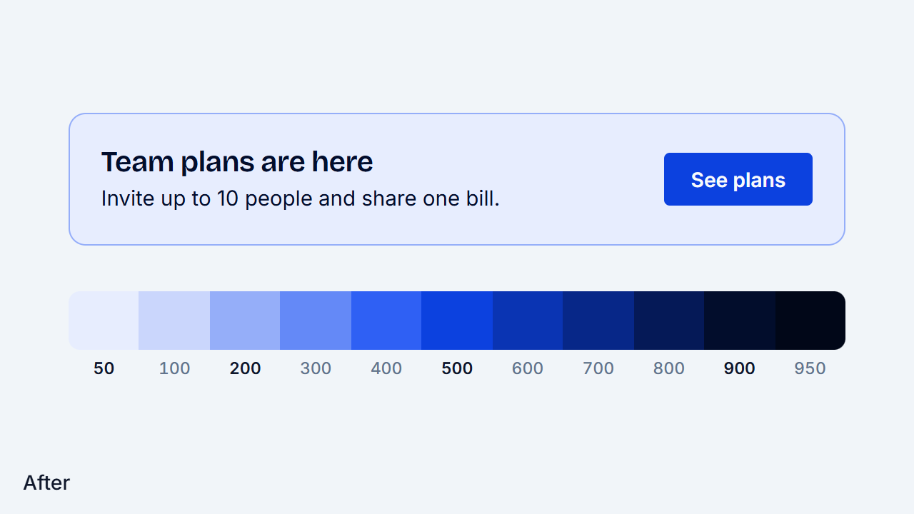

# Build a palette from one brand color

A single brand color rarely covers everything a website needs: a very light version for backgrounds, a slightly darker one for borders, a stronger one for buttons and hover states, and a very dark one for text. Picked by eye one at a time, these colors tend not to quite belong together. A ramp of shades of the same hue keeps them consistent, and most color choices become a matter of picking a step.

## Rule

Build a ramp of 9 to 11 shades of the brand hue, from almost white to almost black, numbered 50 (lightest) to 950 (darkest) with the brand color near the middle, and take every tinted color from a step of that ramp.

## How to apply

1. Generate a starting ramp from the brand color with a palette generator (free ones build one in seconds).
2. Put the brand color near the middle, usually at 500, and adjust individual steps by eye if needed.
3. Store the steps as tokens, from `--brand-50` to `--brand-950`.
4. Pick each role from a step: backgrounds from 50 or 100, borders from 100 or 200, buttons from 500 with hover at 600 or 700, text from 900 or 950.
5. Replace one-off tints in the styles with the nearest ramp step.

```css
:root {
  --brand-50: #E7EDFE;
  --brand-100: #CAD6FC;
  --brand-200: #95AEF9;
  --brand-300: #6489F7;
  --brand-400: #2F60F4;
  --brand-500: #0C41DF; /* the brand color */
  --brand-600: #0A34B3;
  --brand-700: #072788;
  --brand-800: #051957;
  --brand-900: #020D2C;
  --brand-950: #010718;
}

.notice {
  background: var(--brand-50);
  border: 1px solid var(--brand-200);
  color: var(--brand-900);
}

.notice .button { background: var(--brand-500); }
.notice .button:hover { background: var(--brand-600); }
```

## Check your work

- [ ] The palette has 9 to 11 steps of one hue, numbered 50 to 950, with the brand color near the middle.
- [ ] Every tinted background, border, button and text color in the styles is a ramp step, not a one-off hex.
- [ ] The steps run evenly from almost white to almost black, with no jumps in hue.

## When to break it

- Grays and feedback colors, like error red and success green, need ramps of their own; they don't come from the brand ramp.

## Before and after

- **Before:** a Team plans announcement uses the brand blue plus three colors picked one at a time (`#E6F4FB`, `#BFB6F2` and `#2B3445`), which don't quite belong together.
- **After:** the announcement takes its colors from an eleven-step ramp of the brand blue: 50 for the background, 200 for the border, 500 for the button and 900 for the text.

| Before (`before.png`) | After (`after.png`) |
| --- | --- |
|  |  |

## Files

- `before.png` and `after.png`: screenshots of the two states, **Before** and **After**.
- `demo.html`: a self-contained page that shows the lesson working. Open it in a browser.
- `lesson.md`: the lesson as written on designspo.co, word for word.
