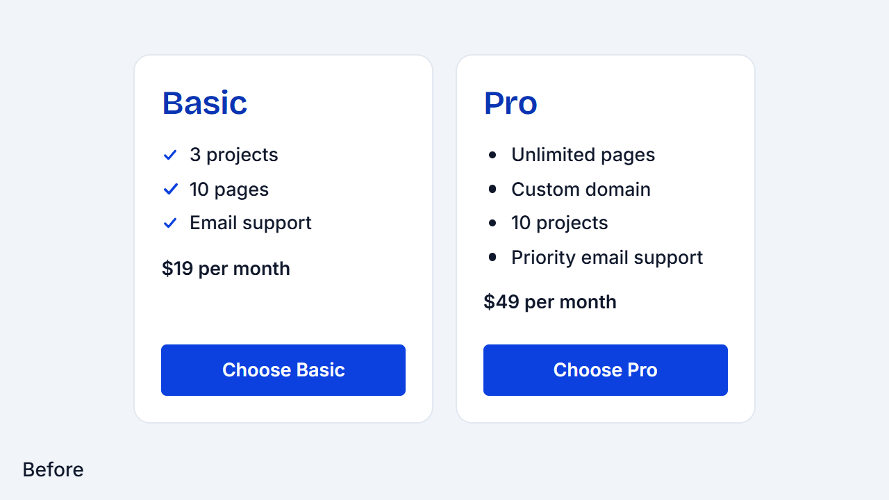
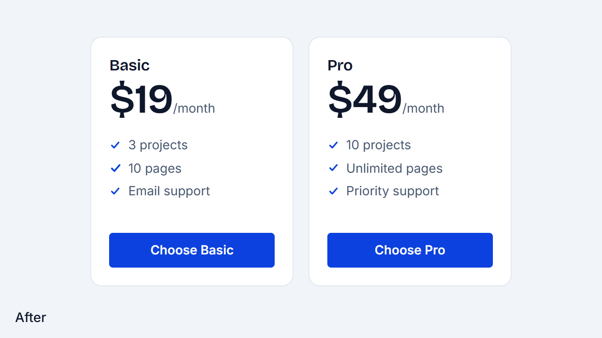

# Build a pricing card

A pricing card has one job: to help people quickly see what they get and what it costs. When the plan name, the price and the features all compete for attention, visitors have to work harder to compare plans. A reliable order, a price that clearly leads and short feature lists written the same way on every plan let people compare cards at a glance.

## Rule

Order every card as plan name, then price, then what's included, with the call to action at the bottom. Make the price the largest text on the card with the billing period small beside it, like "$49/month", and write short feature lists in the same order and style across every plan.

## How to apply

1. Put the plan name first, small and plain.
2. Put the price under it as the largest text on the card, with the billing period in small, muted text on the same line.
3. List what's included: a short list, with matching features in the same order, wording and style on every card (for example projects, then pages, then support).
4. Put the button at the bottom, and make the cards in a row equal height so the buttons line up.

```css
.plan { display: flex; flex-direction: column; }

.plan__name { font-size: 1rem; font-weight: 600; }

.plan__price { font-size: 0.875rem; color: #62748e; } /* the "/month" */
.plan__amount { font-size: 2.75rem; font-weight: 700; color: #0f172b; }

.plan__features { margin: 16px 0 24px; padding: 0; list-style: none; }

.plan__button { margin-top: auto; } /* buttons line up at the bottom */
```

## Check your work

- [ ] On every card the order is plan name, price, features, button.
- [ ] The price amount is the largest text on the card, and the billing period is smaller and lighter, beside it.
- [ ] Feature lists are short and list matching features in the same order, wording and style across plans.
- [ ] The buttons line up along the bottom of the cards.

## When to break it

- A one-line description under the plan name, like "For small teams", is fine as long as it's quieter than the price.
- Custom or enterprise plans can show "Contact us" instead of a price, in the price's place.

## Before and after

- **Before:** Basic ($19) and Pro ($49) cards where the plan name is the biggest text, the price sits under the features at body size ("$19 per month"), and the Pro list is longer, in a different order and with bullets instead of checkmarks.
- **After:** each card shows the plan name, then a large price with a small "/month" beside it, then three checked features in the same order on both cards, with the button at the bottom.

| Before (`before.png`) | After (`after.png`) |
| --- | --- |
|  |  |

## Files

- `before.png` and `after.png`: screenshots of the two states, **Before** and **After**.
- `demo.html`: a self-contained page that shows the lesson working. Open it in a browser.
- `lesson.md`: the lesson as written on designspo.co, word for word.
