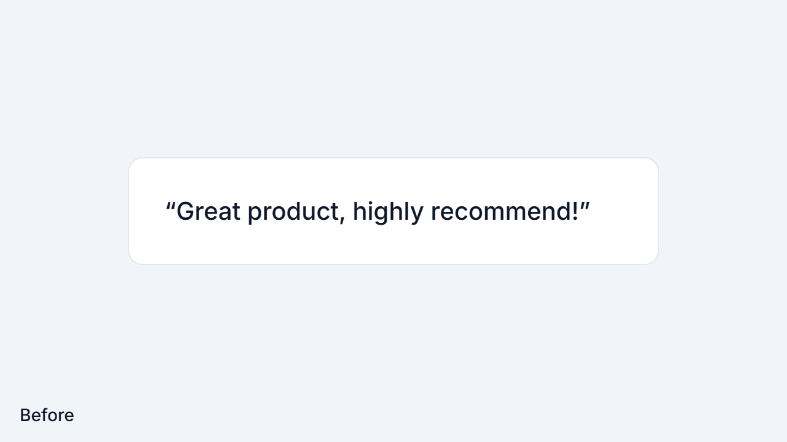
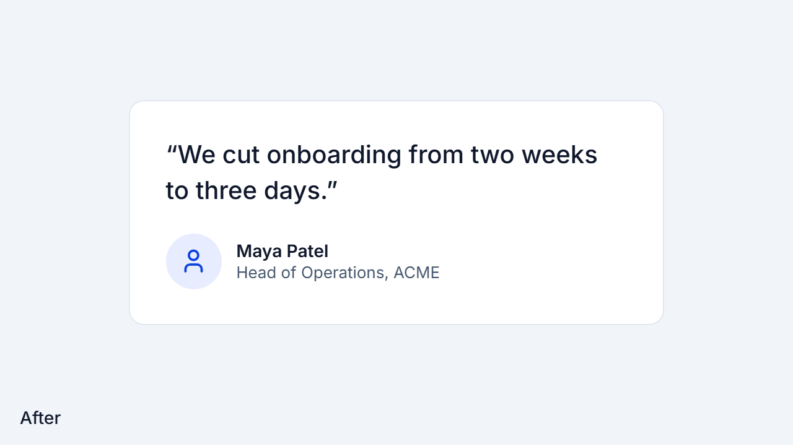

# Write specific testimonials

A testimonial is only as believable as the details it contains. A quote with no name, or a name with no face, can look invented, even when it's real. Show who said it and lead with a specific claim, since specific claims are easier to trust: "We cut onboarding from two weeks to three days" does more work than "Great product, highly recommend."

## Rule

Give every testimonial a short quote, the person's name, their role and/or company, and a real photo. Lead with the most specific sentence the customer wrote, like a number or a clear before and after.

## How to apply

1. Use only real testimonials: the customer's own words, name, role and photo. Never invent any of them; if one is missing, ask for it.
2. Pick the most specific sentence the customer wrote and lead with it. Quote it as written, and keep the quote to two or three lines if you can.
3. Under the quote, put the person's photo beside their name and their role and/or company.
4. Build it as one reusable component: a `figure` with a `blockquote` and a `figcaption`. Give the photo an empty `alt`, since the name beside it already says who it is.

```html
<!-- Example content: use your customer's real words, name, role and photo -->
<figure class="testimonial">
  <blockquote>“We cut onboarding from two weeks to three days.”</blockquote>
  <figcaption>
    
    <span><strong>Maya Patel</strong> Head of Operations, ACME</span>
  </figcaption>
</figure>
```

```css
.testimonial {
  margin: 0;
  padding: 24px;
  border: 1px solid #e5e5e5;
  border-radius: 12px;
}

.testimonial blockquote {
  margin: 0 0 20px;
  font-size: 1.25rem;
}

.testimonial figcaption {
  display: flex;
  align-items: center;
  gap: 12px;
  font-size: 0.875rem;
}

.testimonial img { border-radius: 50%; object-fit: cover; }
.testimonial strong { display: block; }
```

## Check your work

- [ ] Every testimonial shows a quote, the person's name, their role and/or company, and their photo.
- [ ] Each quote leads with a specific detail, like a number or a before and after, and runs about two or three lines at the card's width.
- [ ] No quote, name or photo is a placeholder or made up: no "John Doe", stock portraits or generated faces.
- [ ] The photo is round, not stretched, and sits beside the name and role.

## When to break it

- If a customer can't be named for privacy reasons, show their role and company, and leave out the photo rather than using someone else's.
- A longer quote can work on a page about one customer, like a case study, as long as it opens with the specific sentence.

## Before and after

- **Before:** the card shows only a vague quote, "Great product, highly recommend!" There's no name or picture.
- **After:** a specific quote, "We cut onboarding from two weeks to three days," with a round avatar (a plain user icon standing in for the customer's photo) beside the name, Maya Patel, and the role, Head of Operations, ACME. The card grows to fit them.

| Before (`before.png`) | After (`after.png`) |
| --- | --- |
|  |  |

## Files

- `before.png` and `after.png`: screenshots of the two states, **Before** and **After**.
- `demo.html`: a self-contained page that shows the lesson working. Open it in a browser.
- `lesson.md`: the lesson as written on designspo.co, word for word.
