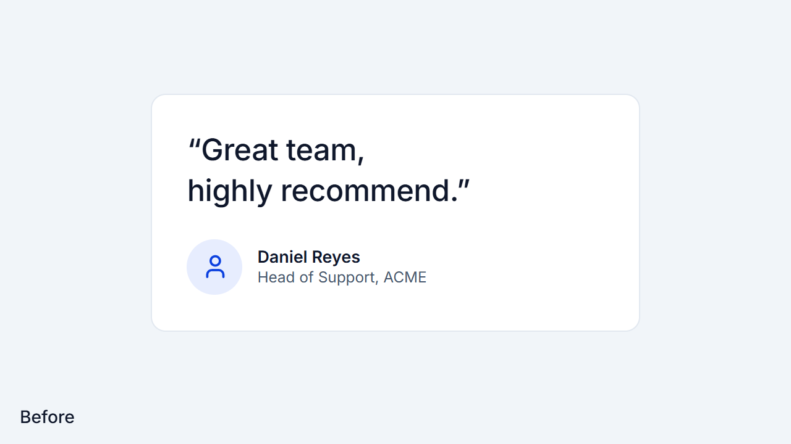
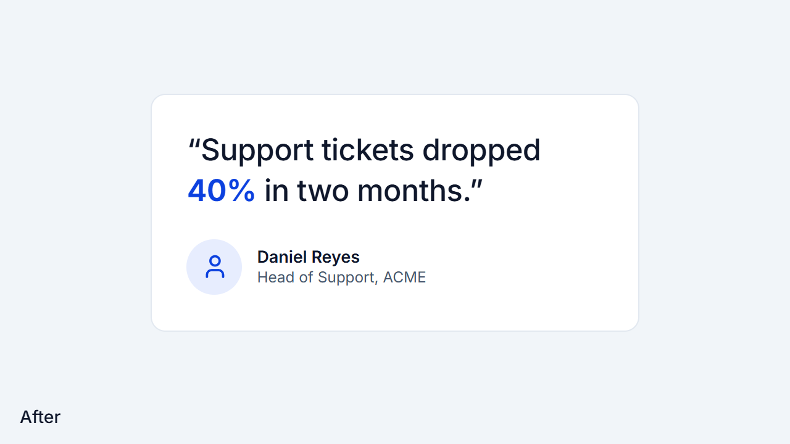

# Choose testimonials with specific results

A testimonial like "Great team, highly recommend" is pleasant to read but easy to forget. It could describe almost any company, so it doesn't tie a specific benefit to your product or service. A testimonial that names a result, like "Support tickets dropped 40% in two months", tells readers exactly what you helped someone achieve, and the number makes it easier to believe.

## Rule

Lead with testimonials that name a specific result: a number, a time frame or a clear before and after. Leave out or demote vague praise.

## How to apply

1. List the site's testimonials and mark each one as specific (a result, a number, a before and after) or vague (general praise).
2. Show the specific ones in the most visible places: the hero, the pricing page and next to calls to action.
3. If a quote is long, lead with its most specific sentence. Keep the customer's exact words, and never invent or inflate a number.
4. If there are no specific testimonials yet, don't write any. Recommend asking customers for numbers or a before and after, with a question like "What changed after you started working with us?", which often draws out the specific answer.

```html
<!-- Example content: use your customer's real words, name and role -->
<figure class="testimonial">
  <blockquote>“Support tickets dropped 40% in two months.”</blockquote>
  <figcaption>Daniel Reyes, Head of Support, ACME</figcaption>
</figure>
```

```css
.testimonial blockquote {
  max-width: 24ch;
  margin: 0 0 16px;
  font-size: 1.5rem;
  text-wrap: balance;
}
```

## Check your work

- [ ] Each featured testimonial names a concrete result, ideally with a number or a before and after.
- [ ] No featured quote could describe almost any company, like "Great team, highly recommend".
- [ ] Every number is in the customer's own words, not added or rounded up.
- [ ] Each testimonial still shows who said it: a name and a role or company.

## When to break it

- Some results don't come with a number. A clear before and after in words, like "We stopped losing leads over the weekend", works too.
- A short quote from a name your audience instantly recognizes can still help, though a specific one from the same person is better.

## Before and after

- **Before:** a testimonial card from Daniel Reyes, Head of Support at ACME, with an avatar (a plain user icon) beside his name, reading "Great team, highly recommend."
- **After:** the same card reads "Support tickets dropped 40% in two months," with "40%" picked out in the brand colour. Nothing else changes.

| Before (`before.png`) | After (`after.png`) |
| --- | --- |
|  |  |

## Files

- `before.png` and `after.png`: screenshots of the two states, **Before** and **After**.
- `demo.html`: a self-contained page that shows the lesson working. Open it in a browser.
- `lesson.md`: the lesson as written on designspo.co, word for word.
