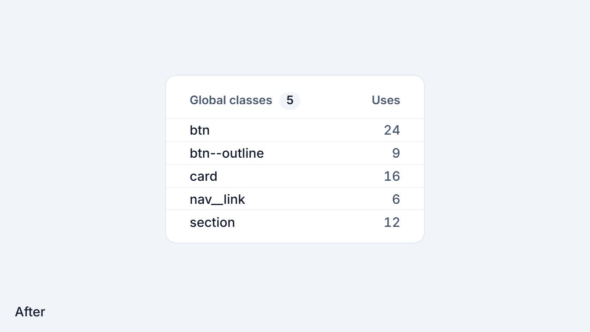

# Clean out unused classes

Over time, classes pile up from old sections, experiments and pages that no longer exist. Each unused class makes the right one a little harder to find, and together they add bloat to the CSS. Going through the class list every few months and deleting what nothing uses keeps the system easy to work with.

## Rule

Every few months, list the site's classes, find the ones no element uses any more, and delete them. Before removing a class you're unsure about, check the places that only appear sometimes, like popups and conditional elements.

## How to apply

1. Get the full class list: the builder's global classes panel, or every class selector in the stylesheets.
2. Find where each class is used. Many no-code builders show a usage count per class. In code, search the templates, components and content for each class name, or ask an AI assistant to cross-reference the stylesheets with the markup; it can often spot unused classes even in messy projects.
3. Mark classes with no uses. Names like `hero-old`, `landing-v1` or `promo-2023` are typical leftovers from old sections and experiments.
4. Before deleting, check the key pages and the places a scan can miss: popups, modals, conditional or logged-in content, and classes added by JavaScript.
5. Delete the unused classes and their CSS, then check the key pages again.

```bash
# A first pass in code: list the class selectors in the CSS, then search the markup and scripts
# for each name. Review every hit by hand before deleting anything.
grep -ohE '\.[a-zA-Z][a-zA-Z0-9_-]*' styles/*.css | sort -u | while read -r cls; do
  grep -rqwF "${cls#.}" templates/ components/ scripts/ || echo "unused? $cls"
done
```

## Check your work

- [ ] Every class left in the list is used by at least one element, template, popup or script.
- [ ] No leftovers from old sections or experiments remain (`-old`, `-v1`, `-test`, year-stamped names).
- [ ] Popups, modals and conditional elements still look right after the cleanup.
- [ ] The cleanup is scheduled to happen again in a few months.

## When to break it

- Keep classes that only appear in popups, conditional elements or content added by JavaScript, even if a scan of the pages says they're unused.
- Keep classes for something about to launch, but give them a clear name and remove them if the launch is dropped.

## Before and after

- **Before:** a Global classes panel with eight classes and how many elements use each. Three of them, `hero-old`, `landing-v1` and `promo-2023`, are used by 0 elements and highlighted in red.
- **After:** those three rows collapse away and the remaining five classes, all in use, close the gap.

| Before (`before.png`) | After (`after.png`) |
| --- | --- |
|  |  |

## Files

- `before.png` and `after.png`: screenshots of the two states, **Before** and **After**.
- `demo.html`: a self-contained page that shows the lesson working. Open it in a browser.
- `lesson.md`: the lesson as written on designspo.co, word for word.
