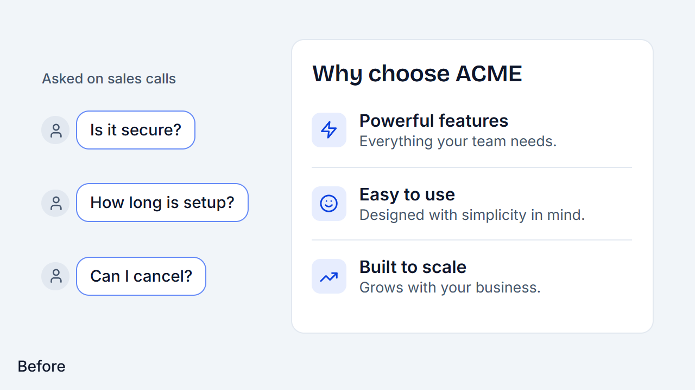
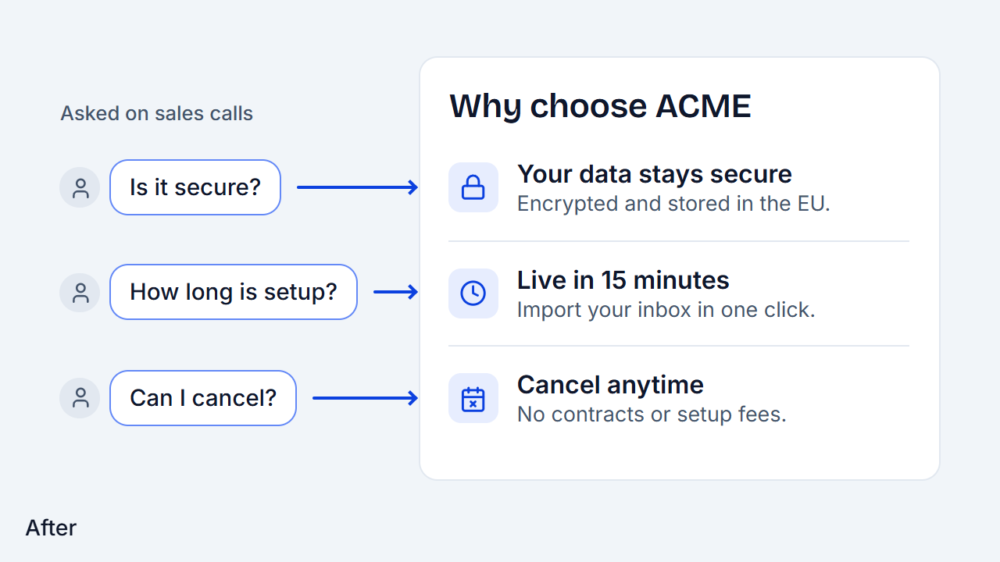

# Collect objections from sales and support

Sales and support teams hear every objection prospects have. They know which questions come up before a purchase and which worries make people walk away. That knowledge often makes it into sales scripts but never onto the website. Answering those objections on the page, where they come up, lets the page do some of the work the team does on calls.

## Rule

Answer the top questions and objections that sales and support actually hear, each on the page where it comes up, instead of benefits or questions written from guesses.

## How to apply

1. Ask sales and support for the top five questions and objections they hear. If you can't ask, read call notes, support tickets and chat logs. This research usually fits in an afternoon.
2. Write each one the way a prospect would ask it, like "Is my data secure?", "How long does setup take?" or "Can I cancel anytime?".
3. Write a short, specific answer for each, and check that it's true for this product.
4. Place each answer where the worry comes up: security near the signup form, setup time on the pricing page, cancelling near the plan or checkout button.
5. Rewrite generic copy that answers questions nobody asks, like benefits titled "Powerful features" or "Easy to use", so each point answers one of these objections instead.

```html
<!-- A benefits section where each point answers a real objection -->
<section class="benefits">
  <h2>Why choose us</h2>
  <ul>
    <!-- "Is it secure?" -->
    <li><h3>Your data stays secure</h3><p>Encrypted and stored in the EU.</p></li>
    <!-- "How long is setup?" -->
    <li><h3>Live in 15 minutes</h3><p>Import your inbox in one click.</p></li>
    <!-- "Can I cancel?" -->
    <li><h3>Cancel anytime</h3><p>No contracts or setup fees.</p></li>
  </ul>
</section>
```

## Check your work

- [ ] The questions on the page come from what sales and support actually hear, not from guesses.
- [ ] Each of the top five objections is answered on a page where it comes up.
- [ ] Every answer is short, specific and true for this product.
- [ ] The signup form and the pricing page answer the worries people have at those points.

## When to break it

- If there's no sales or support team yet, collect questions from emails, chats, reviews and early customer calls instead.
- Keep a full FAQ page if people look for one; the key answers should also appear where each question comes up.

## Before and after

- **Before:** three questions prospects ask on sales calls ("Is it secure?", "How long is setup?", "Can I cancel?") beside a benefits section with generic points that answer none of them: "Powerful features", "Easy to use" and "Built to scale".
- **After:** each benefit is rewritten to answer the question beside it, with an arrow from question to answer: "Your data stays secure", "Live in 15 minutes" and "Cancel anytime".

| Before (`before.png`) | After (`after.png`) |
| --- | --- |
|  |  |

## Files

- `before.png` and `after.png`: screenshots of the two states, **Before** and **After**.
- `demo.html`: a self-contained page that shows the lesson working. Open it in a browser.
- `lesson.md`: the lesson as written on designspo.co, word for word.
