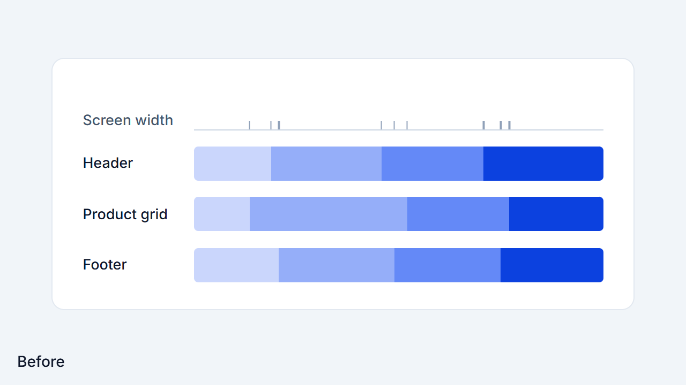
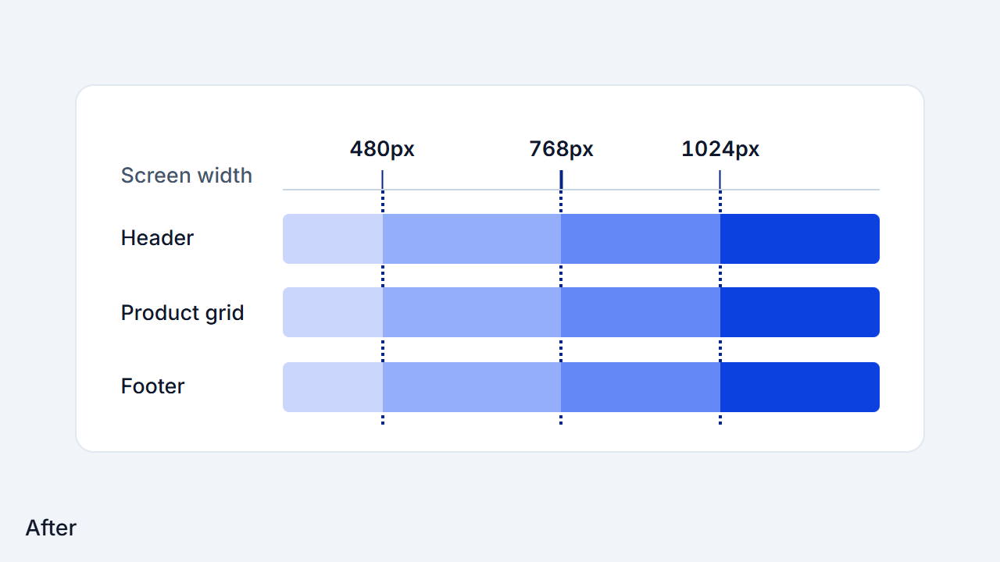

# Define breakpoints once

A breakpoint is the screen width where a layout changes, like a grid dropping from three columns to one. When each component uses its own breakpoints, different parts of the page change at slightly different widths: the header switches at 760px, the grid at 820px, the footer at 790px. In between, some sections can look broken while others have already adjusted. Pick a small set of breakpoints and use only those.

## Rule

Define three or four breakpoints for the whole site, somewhere around 480px, 768px, 1024px and 1440px, and use only those widths in media queries. Don't give a component a breakpoint of its own.

## How to apply

1. Search the CSS for `@media` and list every width in use. Expect near-duplicates like 760px, 768px and 790px.
2. Choose three or four standard breakpoints.
3. Store them in one place. CSS custom properties don't work inside media queries, so use your framework's or page builder's breakpoint settings (Tailwind screens, theme breakpoints), Sass variables, or `@custom-media` with PostCSS.
4. Move each media query to the nearest standard breakpoint, and check the component still works at the widths in between.
5. Write media queries in one direction (for example `min-width`, mobile first), so ranges don't overlap.

```css
/* Site breakpoints: 480px, 768px, 1024px and 1440px. Use only these. */
.site-nav { display: none; }
.product-grid { grid-template-columns: 1fr; }

@media (min-width: 768px) {
  .site-nav { display: flex; }
  .product-grid { grid-template-columns: repeat(2, 1fr); }
  .site-footer { grid-template-columns: repeat(2, 1fr); }
}

@media (min-width: 1024px) {
  .product-grid { grid-template-columns: repeat(3, 1fr); }
  .site-footer { grid-template-columns: repeat(4, 1fr); }
}
```

## Check your work

- [ ] Every media query uses one of the standard breakpoints; searching for `@media` finds no other widths.
- [ ] The breakpoints are defined or documented in one place.
- [ ] Resizing the browser slowly from 320px to 1440px, every section changes layout at the same widths, and nothing looks half-adjusted in between.

## When to break it

- Container queries respond to a component's own width, not the screen's, so they don't need to match the site breakpoints.
- If one component's content really breaks between two breakpoints, like a long navigation, try fixing the content first. If it still needs its own media query, document why.

## Before and after

- **Before:** the Header, Product grid and Footer each change layout at their own widths (around 450 to 520px, 760 to 820px and 1000 to 1060px), so the changes don't line up.
- **After:** all three change at the same breakpoints: 480px, 768px and 1024px.

| Before (`before.png`) | After (`after.png`) |
| --- | --- |
|  |  |

## Files

- `before.png` and `after.png`: screenshots of the two states, **Before** and **After**.
- `demo.html`: a self-contained page that shows the lesson working. Open it in a browser.
- `lesson.md`: the lesson as written on designspo.co, word for word.
