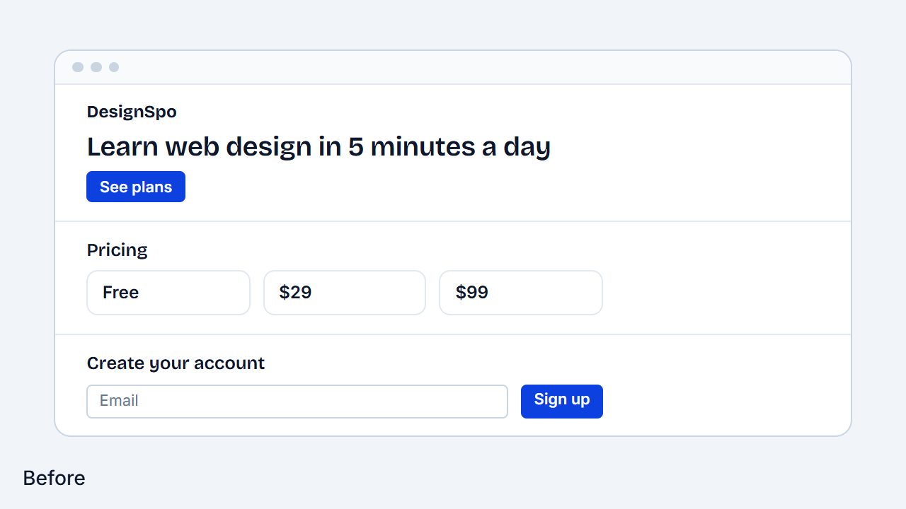
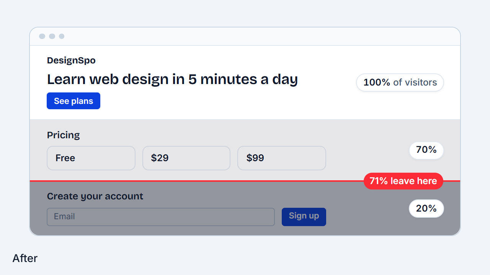

# Find where visitors drop off

A funnel report shows how many visitors reach each step of a path, like the landing page, the pricing page, the form and the thank-you page. Some drop-off at every step is normal. The step with the biggest drop, the bottleneck, is usually where the design needs the most work, and fixing it tends to move the final number more than polishing pages that already work.

## Rule

Before improving pages on a conversion path, build a funnel report for it, work out the drop-off between each pair of steps, and start with the step that loses the most visitors.

## How to apply

1. List the steps of the path in order, for example: landing page, pricing page, form, thank-you page.
2. Build a funnel report for those steps. Most analytics tools can, including Google Analytics (a funnel exploration).
3. For each step after the first, work out the drop-off: 1 − visitors at this step ÷ visitors at the step before.
4. Find the biggest drop: that's the bottleneck. If half the visitors reach the pricing page but only a few start the form, the pricing page or the form is the place to dig in.
5. Look for what stops people there, like unclear prices, a long form or a vague button, fix it, then check the funnel again.
6. When the steps are sections of one long page, use a scroll map (most heatmap tools have one) to see the same drop-off section by section.

```js
const steps = [
  { name: 'Landing page', visitors: 1000 },
  { name: 'Pricing', visitors: 700 },
  { name: 'Form', visitors: 200 },
  { name: 'Thank you', visitors: 150 },
];

const drops = steps.slice(1).map((step, i) => ({
  from: steps[i].name,
  to: step.name,
  dropOff: 1 - step.visitors / steps[i].visitors,
}));

const bottleneck = drops.reduce((a, b) => (b.dropOff > a.dropOff ? b : a));
// { from: 'Pricing', to: 'Form', dropOff: 0.71 }
```

## Check your work

- [ ] The funnel includes every step of the path, in order, over one date range.
- [ ] The drop-off between each pair of steps is worked out, not just the totals.
- [ ] The step with the biggest drop is named as the first thing to fix.
- [ ] Planned changes target that step before pages with smaller drops.

## When to break it

- A step that's meant to filter people out, like a qualifying question before a sales call, can have a big drop on purpose. Check that the people leaving are the ones you want to leave.
- With only a handful of visitors, one or two people can swing a step's drop-off. Use a longer date range before deciding.

## Before and after

- **Before:** a sign-up landing page in a browser window, with a hero, a pricing section and a sign-up form. Nothing shows where visitors leave.
- **After:** a scroll-depth overlay on the same page: 100% of visitors see the hero, 70% reach pricing and only 20% reach the form, which is dimmed. A red line between pricing and the form marks the bottleneck: 71% leave there.

| Before (`before.png`) | After (`after.png`) |
| --- | --- |
|  |  |

## Files

- `before.png` and `after.png`: screenshots of the two states, **Before** and **After**.
- `demo.html`: a self-contained page that shows the lesson working. Open it in a browser.
- `lesson.md`: the lesson as written on designspo.co, word for word.
