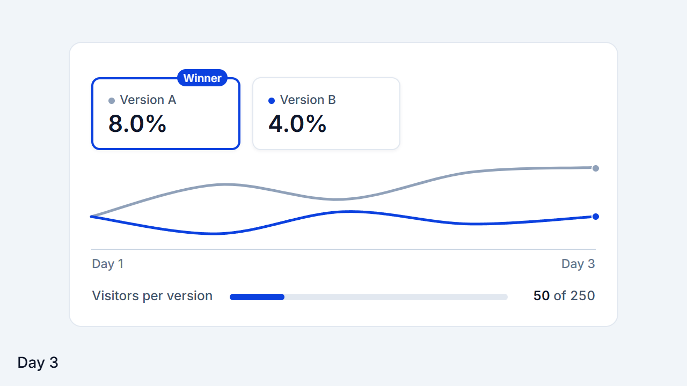
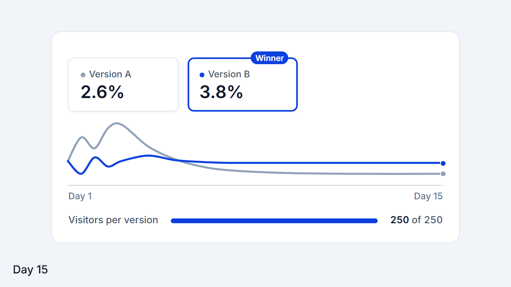

# Give your tests enough time to run

In the first few days of an A/B test, where different visitors see two versions of a page, the results swing up and down radically: one version can look like a clear winner on Monday and fall behind by Friday. Stopping the test while one version happens to be ahead can lead you to keep a change that doesn't really help. Decide how many visitors each version needs before you start, and let the test run until it reaches that number.

## Rule

Set a visitor target for each version before an A/B test starts. Don't stop the test or pick a winner until every version has reached it, however clear the early results look.

## How to apply

1. Look up how many visitors the page gets per month in your analytics.
2. Work out how many visitors each version needs with a free sample size calculator. As a back of the napkin check, wait until at least 25% of the page's monthly traffic has seen the new version: with 1,000 visitors a month, that's at least 250 people.
3. Write the target down with the test, along with roughly how long it will take at the page's current traffic. Lower-traffic sites may need several weeks per test.
4. While the test runs, track progress against the visitor target, not against which version is ahead.
5. When every version has reached the target, compare the results and keep the winner.

```js
// Back of the napkin: at least 25% of the page's monthly visitors should see the new version.
// A sample size calculator gives a better number when you have one.
const minimumVisitors = (monthlyVisitors) => Math.ceil(monthlyVisitors * 0.25);

const test = { visitorsPerVersion: minimumVisitors(1000) }; // 250

// Only call the test once every version has had its visitors
const canPickWinner = (versions) =>
  versions.every((version) => version.visitors >= test.visitorsPerVersion);
```

## Check your work

- [ ] The test has a visitor target per version, set before it started.
- [ ] The target comes from a sample size calculator, or is at least 25% of the page's monthly visitors.
- [ ] No winner is picked, and the test isn't stopped, before every version reaches the target.
- [ ] The planned run time fits the page's traffic: low-traffic pages are planned for several weeks.

## When to break it

- Stop a test straight away if the new version is broken, like a form that doesn't submit. That's a bug, not a result.
- If a page gets so little traffic that a test would take months, an A/B test may not be the right tool there: make the change and watch the numbers, or test it with a few people instead.

## Before and after

- **Day 3:** 50 of 250 visitors per version. The lines swing up and down, and the results card outlines version A as the winner, converting 8.0% of its visitors against 4.0% for B.
- **Day 15:** 250 of 250 visitors per version. The early swings have settled and B is the real winner, at 3.8% against 2.6%, so the outline has moved to B. Stopping on day 3 would have picked the wrong version.

| Day 3 (`before.png`) | Day 15 (`after.png`) |
| --- | --- |
|  |  |

## Files

- `before.png` and `after.png`: screenshots of the two states, **Day 3** and **Day 15**.
- `demo.html`: a self-contained page that shows the lesson working. Open it in a browser.
- `lesson.md`: the lesson as written on designspo.co, word for word.
