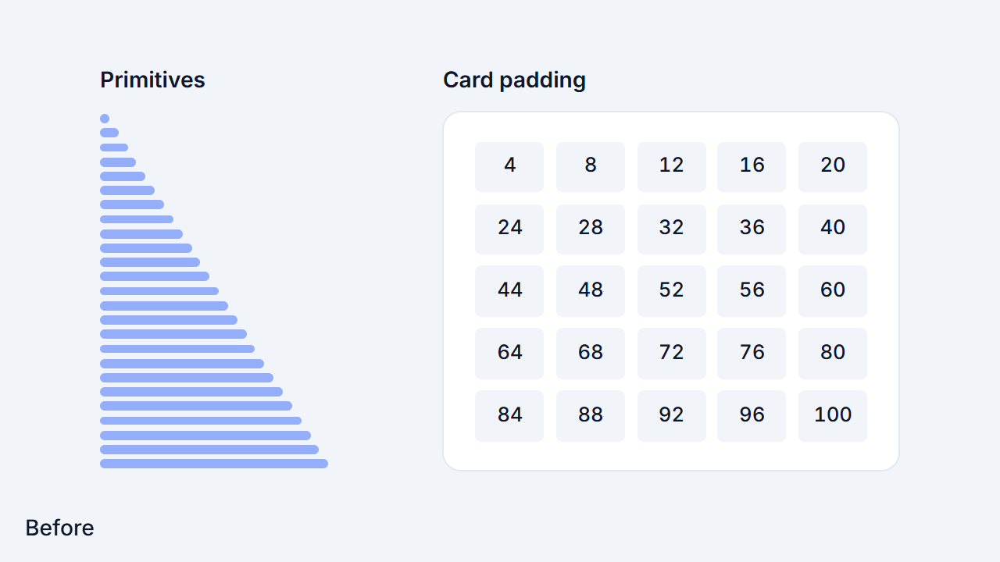
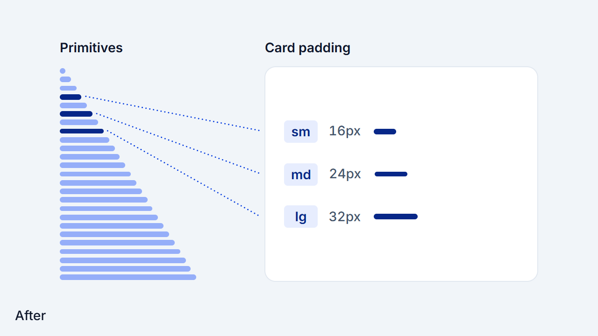

# Keep your scales short

Most design systems start with a long list of raw values, called primitives: a spacing scale might run from 4px to 1440px in small steps, and that's fine, because it covers almost any layout. The trouble starts when every component can use every one of those values. If card padding can be any of 25 sizes, cards across the site slowly drift apart and nobody remembers which size is right. Give each component a short list of three or four options instead, each pointing to one primitive.

## Rule

Keep the full primitive scale, but don't let components use it directly. Give each component (or each spacing property of a component) three or four named options, like small, medium and large, whose values are primitives, and use only those options in the component's styles.

## How to apply

1. Keep the primitives as they are: one token per raw value, usually CSS custom properties on `:root` in a global tokens file.
2. For each component that has spacing, decide how many sizes it really needs. Three or four is usually enough: small, medium and large card padding, for example.
3. Add a component token for each option, and set its value to a primitive token, not a raw pixel value.
4. Replace the primitives and raw values in the component's styles with its own options.
5. Use the same option for the same kind of card on every page.

```css
:root {
  /* Primitives: the full scale */
  --space-4: 4px;
  --space-8: 8px;
  /* ...every step in between... */
  --space-100: 100px;

  /* Card padding: three options, each pointing to a primitive */
  --card-padding-sm: var(--space-16);
  --card-padding-md: var(--space-24);
  --card-padding-lg: var(--space-32);
}

.card { padding: var(--card-padding-md); }
.card--compact { padding: var(--card-padding-sm); }
.card--feature { padding: var(--card-padding-lg); }
```

## Check your work

- [ ] Every component with spacing has its own list of three or four options.
- [ ] Each option's value is a primitive token (`var(--space-24)`), not a raw value like `24px`.
- [ ] Component styles use their own options, not the primitives: searching the component styles for `var(--space-` finds nothing.
- [ ] Cards of the same kind have the same padding on every page.
- [ ] The primitive scale itself is unchanged.

## When to break it

- Experienced designers can sometimes work straight from the full scale. Short lists matter most when several people build pages, or when the system has to stay consistent for a long time.
- If a component keeps needing a size its list doesn't have, add one option to its list and point it at a primitive, rather than reaching past the list.

## Before and after

- **Before:** spacing primitives from 4px to 100px in 25 steps, and card padding can use any of the 25 values.
- **After:** the same 25 primitives, but card padding offers only sm, md and lg, which point to the 16px, 24px and 32px primitives.

| Before (`before.png`) | After (`after.png`) |
| --- | --- |
|  |  |

## Files

- `before.png` and `after.png`: screenshots of the two states, **Before** and **After**.
- `demo.html`: a self-contained page that shows the lesson working. Open it in a browser.
- `lesson.md`: the lesson as written on designspo.co, word for word.
