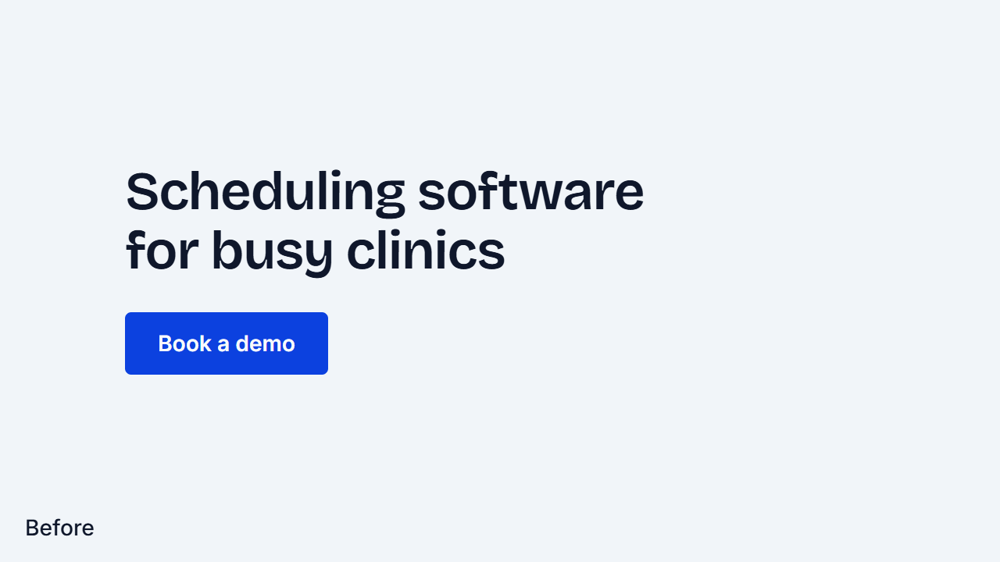

# Offer a smaller first step

Many visitors, especially first-time visitors, are interested but not ready for a big commitment like booking a sales call. If that's the only option on the page, they may simply leave and forget about you. A smaller first step beside the main action, like a free guide, a product tour or a free trial, can reduce risk, collect leads and keep people in touch until they're ready.

## Rule

Next to a call to action that asks for a big commitment, add one smaller first step. Style it as a secondary button or a text link, so the main action still stands out for visitors who are ready now.

## How to apply

1. Find the main calls to action, starting with the hero, and note the ones that ask for a big commitment, like booking a call or a demo.
2. Choose a smaller step the business actually offers, like a free guide, a product tour or a free trial, and link it to its real page. If there's none, flag it rather than inventing one.
3. Place it right after the main action, in the same row.
4. Keep the main action as the filled button. Give the smaller step an outline, or make it a text link.

```html
<div class="cta">
  <a class="button" href="/book-a-demo">Book a demo</a>
  <a class="button button--secondary" href="/tour">Take the tour</a>
</div>
```

```css
.cta {
  display: flex;
  flex-wrap: wrap;
  gap: 0.5rem;
}

/* The main .button keeps its fill. The smaller step gets an outline instead. */
.button--secondary {
  border: 1px solid #CAD5E2;
  background: transparent;
  color: inherit;
}
```

## Check your work

- [ ] Each call to action that asks for a big commitment has a smaller first step right beside it.
- [ ] The smaller step links to a real page, not `#`.
- [ ] The main action comes first and is still the most prominent: filled, in the strongest color.
- [ ] The smaller step is an outlined button or a text link, not a second filled button.

## When to break it

- If the main action is already a small step, like a free trial or a free download, it doesn't need a smaller one beside it.
- On pages built to finish one task, like a checkout or a booking form, keep the focus on that one action.

## Before and after

- **Before:** a hero with the headline "Scheduling software for busy clinics" and a single filled Book a demo button.
- **After:** an outlined Take the tour button sits beside Book a demo as a smaller first step, and Book a demo still stands out.

| Before (`before.png`) | After (`after.png`) |
| --- | --- |
|  |  |

## Files

- `before.png` and `after.png`: screenshots of the two states, **Before** and **After**.
- `demo.html`: a self-contained page that shows the lesson working. Open it in a browser.
- `lesson.md`: the lesson as written on designspo.co, word for word.
