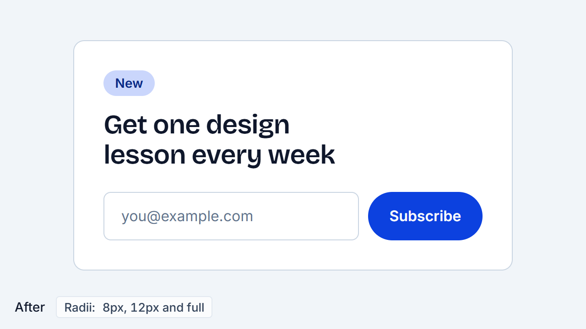

# Pick a small set of corner radii

Corner radius is how rounded an element's corners are. When every component gets its own value, like 5px on buttons, 7px on cards and 10px on inputs, the site starts to look slightly inconsistent: most visitors couldn't tell you why, but they still feel it. The fix is a small set of radius values, stored as tokens and reused everywhere.

## Rule

Use only three or four corner radius values across the site, each stored as a token (a named variable like `--radius-md`). Every `border-radius` should use one of those tokens.

## How to apply

1. Search the styles for every `border-radius` value and list the distinct ones.
2. Choose three or four values by role, for example a small radius for inputs, a medium one for cards and a fully rounded one for pill buttons and tags.
3. Define them as tokens in one place, usually `:root` in the global stylesheet, so you can reuse them everywhere and change each one in one place later.
4. Replace every hard-coded radius with the token for its role. Values that are only slightly different, like 5px and 7px, become the same token.

```css
:root {
  --radius-sm: 8px;      /* inputs */
  --radius-md: 12px;     /* cards */
  --radius-full: 9999px; /* pill buttons and tags */
}

.card { border-radius: var(--radius-md); }
input, select, textarea { border-radius: var(--radius-sm); }
.button, .tag { border-radius: var(--radius-full); }
```

## Check your work

- [ ] The codebase uses no more than three or four distinct radius values, not counting `0` for square corners.
- [ ] Every non-zero `border-radius` uses a token, like `var(--radius-md)`, not a raw pixel value.
- [ ] Components of the same kind share one radius: all cards match, all inputs match, and all pill buttons and tags match.

## When to break it

- Decorative shapes, like blobs drawn with `border-radius`, aren't components and can use any value.
- Third-party widgets and embeds you can't restyle can keep their own radius.

## Before and after

- **Before:** a newsletter signup card with a tag, an email input and a Subscribe button, each with its own radius: 2px on the card, 4px on the tag, 6px on the button and 16px on the input. The input is rounder than the card it sits in, and the button beside it is nearly square.
- **After:** three radius tokens: 12px on the card, 8px on the input, and fully rounded corners on the button and the tag.

| Before (`before.png`) | After (`after.png`) |
| --- | --- |
|  |  |

## Files

- `before.png` and `after.png`: screenshots of the two states, **Before** and **After**.
- `demo.html`: a self-contained page that shows the lesson working. Open it in a browser.
- `lesson.md`: the lesson as written on designspo.co, word for word.
