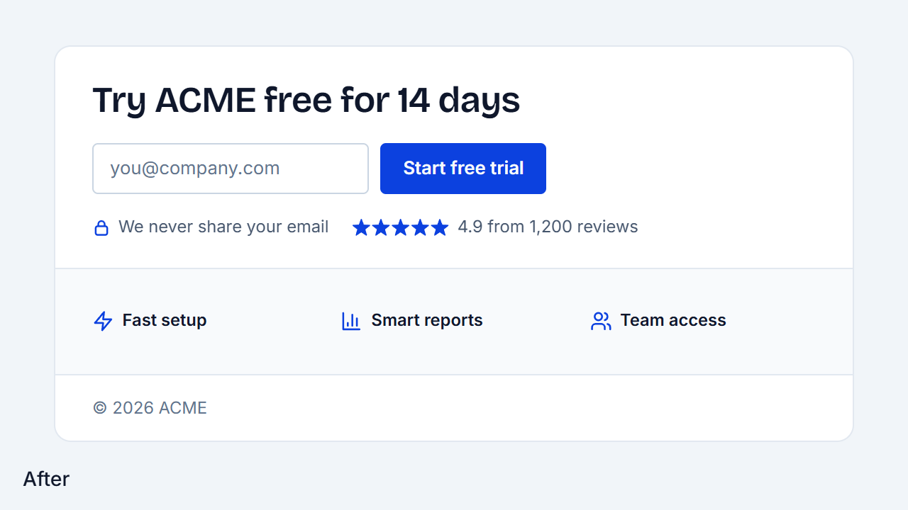

# Place trust signals near the next step

People hesitate most right before they commit, like when they're about to submit a form or enter their card details. That's when small doubts show up: is my data safe, does this product really work? A security badge, a review rating or a short guarantee placed beside the form or checkout button answers those doubts at that moment. The same signals tucked away in the footer usually do much less, because visitors aren't looking at the footer while they're making a decision.

## Rule

Place one or two short trust signals directly under or beside every submit and checkout button. Don't leave them only in the footer.

## How to apply

1. Find the points where people commit: signup and demo forms, checkout and payment steps.
2. Collect the trust signals the site already has and can back up: a privacy promise ("We never share your email"), a review rating with its count, a security badge, a guarantee.
3. Match the signal to the doubt at that step: privacy for an email field, security for card details, a rating or guarantee for "does it really work?".
4. Put one or two of them right under the button, as short lines of small but readable text, each with a simple icon. If they only live in the footer, move or repeat them there.
5. Link the note to the button with `aria-describedby`, so screen reader users hear it too.

```html
<form class="signup">
  <input type="email" name="email" placeholder="you@company.com" aria-label="Work email">
  <button type="submit" aria-describedby="trust">Start free trial</button>
  <ul class="trust" id="trust">
    <li>We never share your email</li>
    <li>4.9 from 1,200 reviews</li>
  </ul>
</form>
```

```css
.trust {
  display: flex;
  flex-wrap: wrap;
  gap: 4px 16px;
  margin: 12px 0 0;
  padding: 0;
  list-style: none;
  font-size: 0.8125rem;
  color: #45556c; /* muted, but at least 4.5:1 contrast on white */
}
```

## Check your work

- [ ] Every submit and checkout button has at least one trust signal right next to it, visible without scrolling away from the button.
- [ ] Each signal is specific and true: a real rating with its count, a privacy promise the site keeps, a guarantee it honors.
- [ ] The signals are short, ideally one line each, and don't compete with the button.
- [ ] No trust signal that matters to the decision appears only in the footer.

## When to break it

- Low-stakes links, like "Read more", don't need trust signals.
- Don't pile them up: one or two relevant signals near the button work better than a wall of badges.

## Before and after

- **Before:** a signup page with an email field and a Start free trial button, then a row of features and a footer. The trust signals, "We never share your email" and a five-star "4.9 from 1,200 reviews", sit at the far end of the footer, past the rest of the page.
- **After:** the same two signals glide up from the footer and sit right under the button.

| Before (`before.png`) | After (`after.png`) |
| --- | --- |
|  |  |

## Files

- `before.png` and `after.png`: screenshots of the two states, **Before** and **After**.
- `demo.html`: a self-contained page that shows the lesson working. Open it in a browser.
- `lesson.md`: the lesson as written on designspo.co, word for word.
