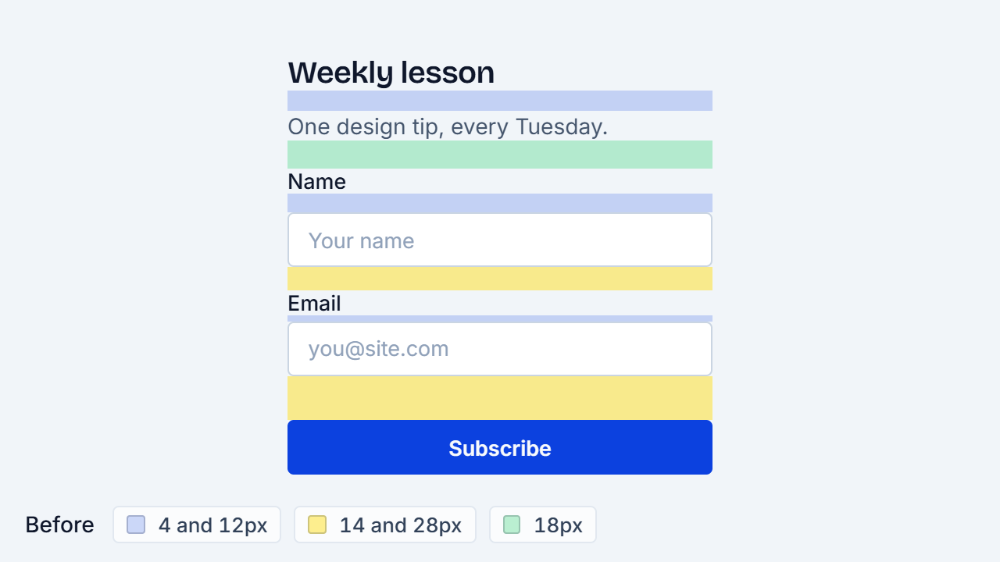
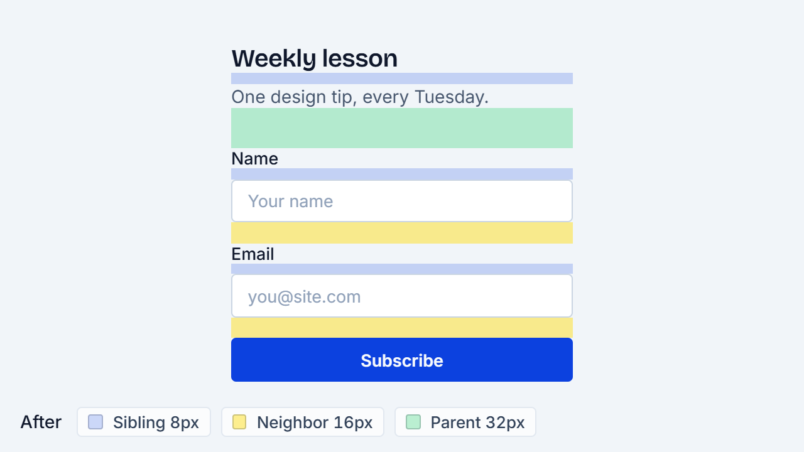

# Relational Spacing

The space between two elements tells visitors how closely they are related: a form field and its label sit close together, while two columns in a section sit farther apart. When each gap is picked on its own, pairs that relate the same way end up with different spacing, and the layout feels inconsistent across sections and pages. Relational spacing rules map spacing values onto relationships, so pairs that relate the same way always get the same space.

## Rule

Define a few spacing tokens named for relationships, from closest to loosest, and space every pair of elements with the token for how they relate, in every component and section.

## How to apply

1. Choose three or four relationships and give each a value from your spacing scale. For example: sibling 8px (a label and its input, a heading and its subheading), neighbor 16px (one field and the next, a field and its button, two buttons in a call to action), parent 32px (a heading and the content it introduces).
2. Define them as tokens or utility classes in your global styles. Map existing utilities (like gap-small) onto them rather than using sizes directly.
3. For each gap, decide how the two elements relate, then use that relationship's token.
4. Reuse the same mapping everywhere, so the same relationship looks the same in a form, a card grid or a hero.

```css
:root {
  --space-sibling: 8px;   /* label and input, heading and subheading */
  --space-neighbor: 16px; /* field and field, field and button, button and button */
  --space-parent: 32px;   /* heading and the content it introduces */
}

.form-header { display: grid; gap: var(--space-sibling); margin-bottom: var(--space-parent); }
.form { display: grid; gap: var(--space-neighbor); }
.field { display: grid; gap: var(--space-sibling); }
.cta { display: flex; gap: var(--space-neighbor); }
```

## Check your work

- [ ] Every gap and margin between elements uses one of the relationship tokens.
- [ ] Pairs that relate the same way have the same spacing everywhere: every label is the same distance from its input, every field the same distance from the next.
- [ ] Closer relationships get smaller values: sibling is less than neighbor, and neighbor less than parent.
- [ ] In a screenshot, each label sits clearly closer to its own input than to the field above it.

## When to break it

- If you need more steps than meaningful names can cover, conventional names like spacing-1 and spacing-2 work too. Keep a note of which relationship each one is for, and still give the same relationship the same value.

## Before and after

- **Before:** a signup form whose gaps were picked one by one. The labels sit 4 or 12px from their inputs, the fields 14 or 28px apart, and the heading only 18px above the form, closer than the button is to the last field.
- **After:** every sibling gap (heading and subheading, label and input) is 8px, every neighbor gap (field and field, field and button) is 16px, and the parent gap between the heading and the form is 32px.

| Before (`before.png`) | After (`after.png`) |
| --- | --- |
|  |  |

## Files

- `before.png` and `after.png`: screenshots of the two states, **Before** and **After**.
- `demo.html`: a self-contained page that shows the lesson working. Open it in a browser.
- `lesson.md`: the lesson as written on designspo.co, word for word.
