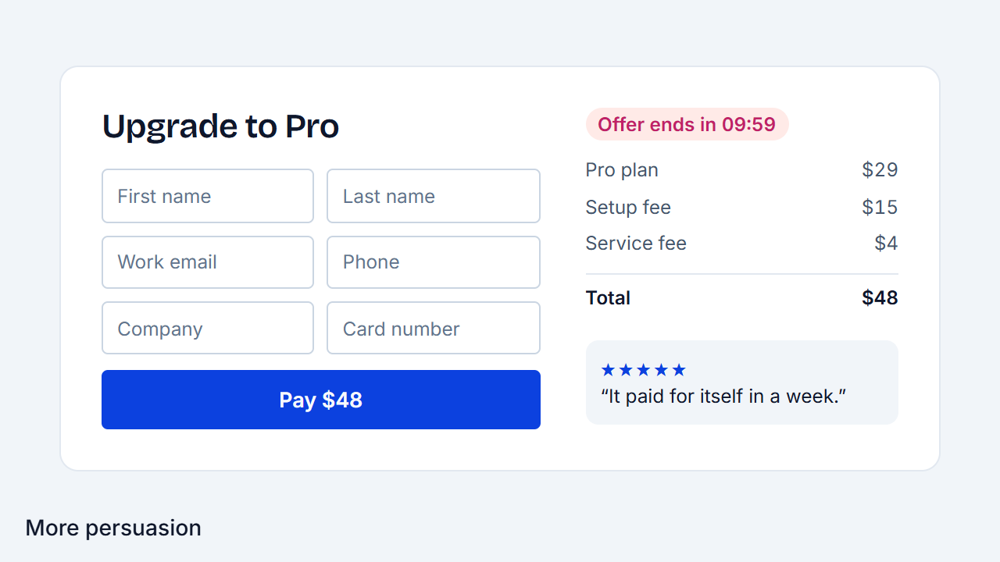
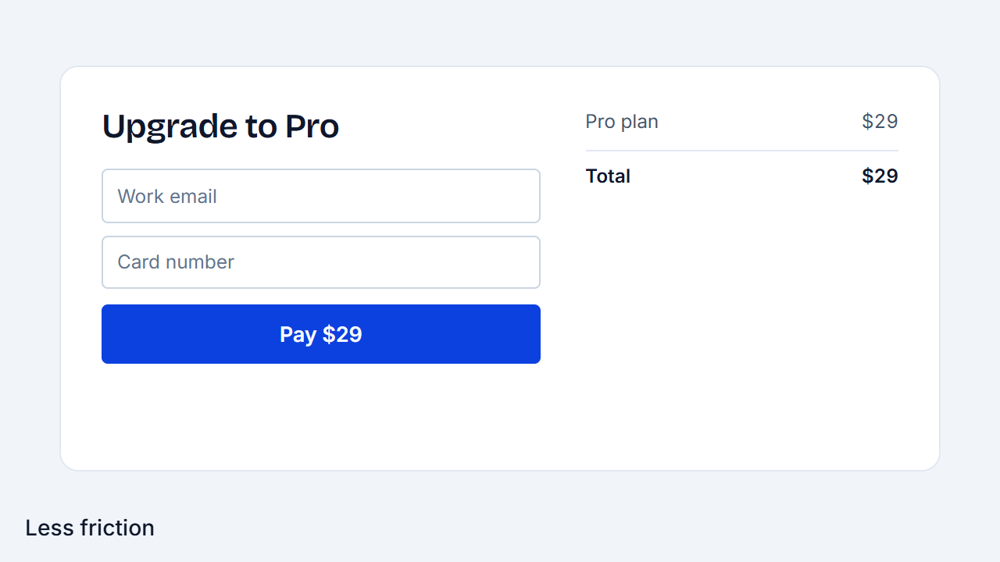

# Remove friction before adding persuasion

When a page isn't converting (turning visitors into customers), it's tempting to add more: extra testimonials, bolder headlines, countdown timers. But often the problem is friction, meaning anything that makes the next step harder than it needs to be. Slow pages, long or confusing forms and surprise costs at checkout can lose more visitors than weak persuasion ever does, so fixing them can do more than a stronger pitch.

## Rule

When a page underperforms, look for friction first, from the first click to the final confirmation, and remove it before adding any new persuasive content.

## How to apply

1. Go through the whole path yourself, or ask someone else to, from the first click to the final confirmation. Note every moment that feels slow or unclear.
2. Speed: measure the key pages (Lighthouse or PageSpeed Insights). Compress and lazy-load images, and remove scripts the page doesn't need.
3. Forms: remove every field that isn't needed to complete this step. A checkout usually needs an email and payment details; ask for anything else later, if at all.
4. Costs: show the full price, fees included, wherever a price first appears, so the total at checkout matches what people expected.
5. Only then consider extra persuasion, like testimonials or a stronger headline, and measure whether it helps.

```html
<!-- Only what's needed to pay, at the price that was advertised -->
<form class="checkout">
  <label>Work email <input type="email" name="email" autocomplete="email" required></label>
  <label>Card number <input name="cc-number" autocomplete="cc-number" inputmode="numeric" required></label>
  <button type="submit">Pay $29</button>
</form>
```

## Check your work

- [ ] Every form field is needed to complete that step.
- [ ] The total at checkout equals the price shown earlier, with no fees added at the end.
- [ ] Key pages load quickly on a phone: Largest Contentful Paint under 2.5 seconds.
- [ ] Someone can get from the first click to the confirmation without getting stuck or wondering what happens next.
- [ ] No countdown timers or extra testimonials were added to make up for friction that's still there.

## When to break it

- If the path is already fast, short and clear, the problem may really be the message: then work on the headline and the proof.
- Keep fields you're legally required to collect, like a billing address for tax.

## Before and after

- **More persuasion:** a checkout for a $29-a-month Pro plan gets a countdown timer and a five-star testimonial, but the form still asks for six fields, and a setup fee and a service fee push the total to $48.
- **Less friction:** no timer or testimonial; the form asks only for a work email and a card number, and the button reads "Pay $29".

| More persuasion (`before.png`) | Less friction (`after.png`) |
| --- | --- |
|  |  |

## Files

- `before.png` and `after.png`: screenshots of the two states, **More persuasion** and **Less friction**.
- `demo.html`: a self-contained page that shows the lesson working. Open it in a browser.
- `lesson.md`: the lesson as written on designspo.co, word for word.
