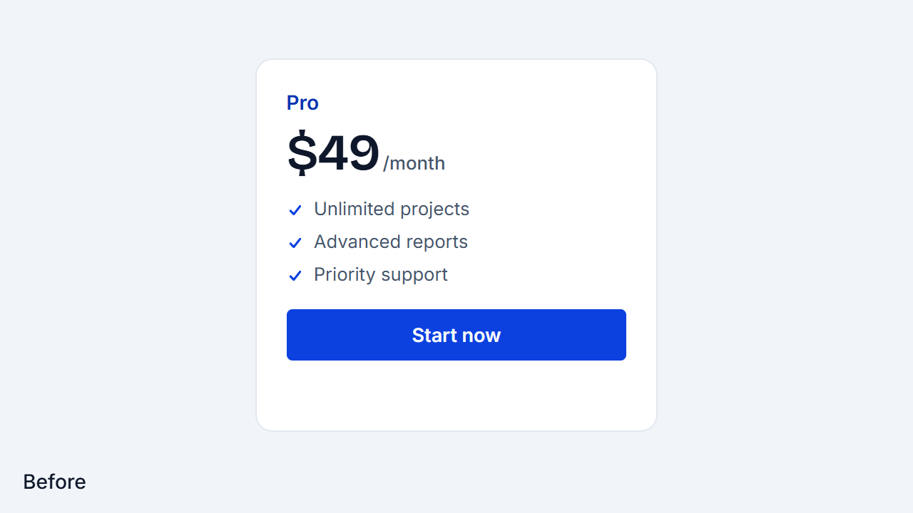
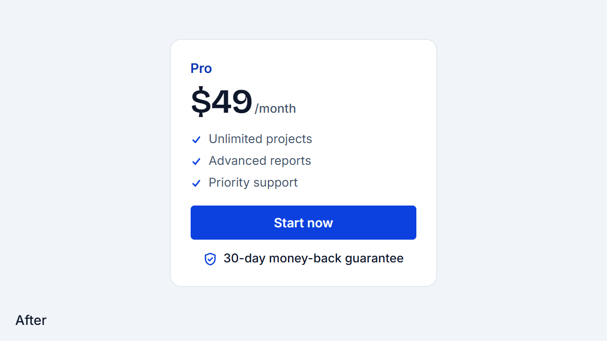

# Reverse the risk with a guarantee

Every purchase carries some risk for the buyer. They might pay and find the product isn't right for them, or sign a contract and regret it a month later. Copy, proof and design can reduce that perceived risk, but some always remains, and it's often what makes people put the decision off. A guarantee, like a 30-day money-back guarantee or a free trial, moves some of that risk from the buyer to the business, so people can try the product knowing they can back out if it doesn't work for them.

## Rule

State the guarantee plainly, in one short line, right next to the price and the buy button, where people weigh the decision. Only offer terms the business is comfortable keeping, and honor them without a fight.

## How to apply

1. Confirm the guarantee the business actually offers: how long it lasts, what it covers and how to claim it. If there isn't one, ask the site owner rather than inventing one.
2. Write it as one plain line, like "30-day money-back guarantee" or "Try it free for 14 days, cancel anytime".
3. Put it directly under the main button on each pricing card and at checkout, with a simple icon, readable but quieter than the button.
4. Link to the full terms, for example in the FAQ or the refund policy, but never hide the promise itself there.

```html
<div class="plan">
  <h3>Pro</h3>
  <p class="price">$49<span>/month</span></p>
  <a class="button" href="/signup?plan=pro" aria-describedby="guarantee">Start now</a>
  <p class="guarantee" id="guarantee">30-day money-back guarantee</p>
</div>
```

```css
.guarantee {
  margin: 12px 0 0;
  font-size: 0.875rem;
  font-weight: 500;
  text-align: center;
}
```

## Check your work

- [ ] The guarantee appears right next to the price and the buy button, not only in an FAQ, the footer or the terms.
- [ ] It's one short, plain line, with no fine print attached to it.
- [ ] Its terms match the refund policy and what the business actually does.
- [ ] It's easy to read but doesn't compete with the button.

## When to break it

- If the business can't honor a guarantee without a fight, don't offer one: a broken promise costs more trust than no promise.
- Free and low-stakes actions, like a newsletter signup, don't need a guarantee.

## Before and after

- **Before:** a Pro pricing card at $49 a month with three features and a Start now button, with nothing under the button.
- **After:** a line right under the button reads "30-day money-back guarantee", with a shield icon.

| Before (`before.png`) | After (`after.png`) |
| --- | --- |
|  |  |

## Files

- `before.png` and `after.png`: screenshots of the two states, **Before** and **After**.
- `demo.html`: a self-contained page that shows the lesson working. Open it in a browser.
- `lesson.md`: the lesson as written on designspo.co, word for word.
