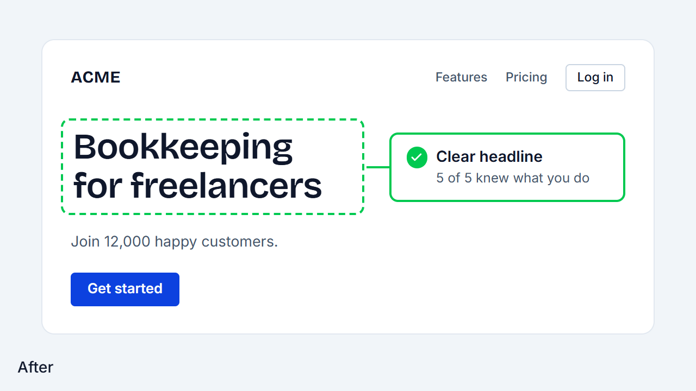

# Run a five-second test on your hero

Most visitors decide within a few seconds whether a page is worth their time. A five-second test checks whether the hero section (the first section visitors see) gets its message across in that short window: show it to someone for five seconds, hide it, and ask what the company does. If they can't say, or they describe something different, the headline probably needs work.

## Rule

Before launch, run a five-second test on the hero with a few people who haven't seen the page. If most of them can't say what the company does, rewrite the headline, check that it's the first thing people read, and test again.

## How to apply

1. Take a screenshot of the hero exactly as visitors first see it.
2. Find a few people who haven't seen the page before. Anyone works: colleagues from another team, friends, or a remote testing tool.
3. Show each person the screenshot for five seconds, then hide it.
4. Ask one question, "What does this company do?", and write the answer down word for word.
5. Mark each answer right or wrong against what the company actually does.
6. If most answers are wrong or unsure, rewrite the headline to say plainly what you do and who it's for, make it the most prominent text in the hero, and test again with new people.

```html
<!-- Vague: nobody can tell what the company does in five seconds -->
<h1>Take control of your future</h1>

<!-- Clear: says what it is and who it's for -->
<h1>Bookkeeping for freelancers</h1>
```

## Check your work

- [ ] The hero headline names what the company offers in words visitors would use (like "bookkeeping software"), not only a benefit or a slogan.
- [ ] The headline is the largest, highest-contrast text in the hero, so it's what people read first.
- [ ] The hero was shown for five seconds to people who hadn't seen the page, and most of them described what the company does.

## When to break it

- A brand everyone already knows can lead with a slogan, because visitors arrive knowing what it does.
- A five-second test only checks the first impression. It won't tell you whether the rest of the page convinces people.

## Before and after

- **Before:** a full hero section (logo, navigation, headline, one line of text and a "Get started" button) with the headline "Take control of your future". A callout pointing at the headline gives the five-second test result: "Vague headline, 0 of 5 knew what you do".
- **After:** the same hero with the headline "Bookkeeping for freelancers", and the callout says "Clear headline, 5 of 5 knew what you do".

| Before (`before.png`) | After (`after.png`) |
| --- | --- |
|  |  |

## Files

- `before.png` and `after.png`: screenshots of the two states, **Before** and **After**.
- `demo.html`: a self-contained page that shows the lesson working. Open it in a browser.
- `lesson.md`: the lesson as written on designspo.co, word for word.
