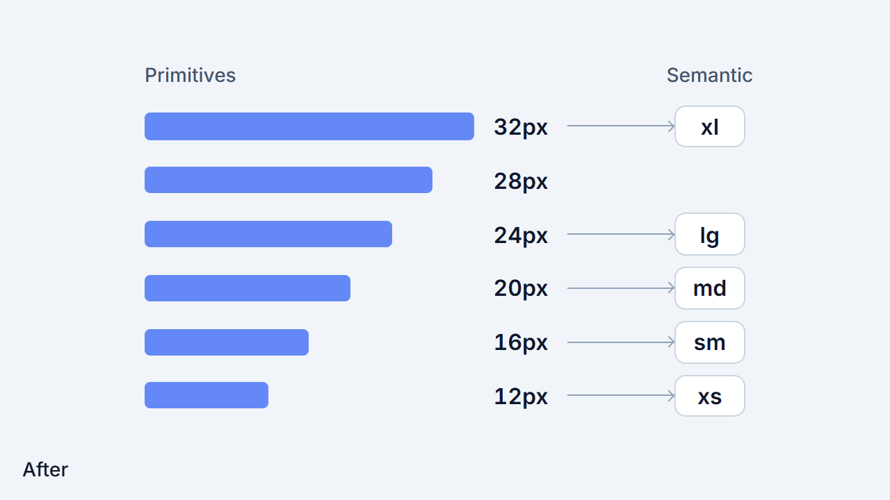

# Semantic Scaling

A scaling system starts with raw values (4px, 8px, 12px and so on), then gives those values names with meaning, like small, medium and large. Keeping the two layers separate does two things. Names are far easier to remember than pixel values, especially on a ratio scale, where 4px is followed by about 6.5px (4 × 1.618). And a name can be mapped onto a different value later without touching the scale, so anything else still using the old value is unaffected.

## Rule

Define the raw values once as primitive tokens, define semantic tokens whose values are primitive tokens, and use the semantic tokens in components. To change a size, point its semantic token at another primitive; don't edit or delete the primitive.

## How to apply

1. List the scale's raw values and define each one as a primitive token, usually as CSS custom properties on `:root` in a global tokens file.
2. Define semantic tokens with meaningful names (xs, sm, md, lg, xl, or small, medium, large), each set to a primitive token, never to a raw number.
3. Replace raw sizes in component styles with semantic tokens.
4. When a size should change, for example extra large from 28px to 32px, map the semantic token onto the other primitive. Keep 28px in the scale for anything else that uses it.

```css
:root {
  /* Primitive tokens: the raw scale */
  --size-12: 12px;
  --size-16: 16px;
  --size-20: 20px;
  --size-24: 24px;
  --size-28: 28px;
  --size-32: 32px;

  /* Semantic tokens: names mapped onto the scale */
  --space-xs: var(--size-12);
  --space-sm: var(--size-16);
  --space-md: var(--size-20);
  --space-lg: var(--size-24);
  --space-xl: var(--size-32); /* was var(--size-28), which stays in the scale */
}

.section { padding-block: var(--space-xl); }
.card { padding: var(--space-md); }
```

## Check your work

- [ ] Every primitive token holds a raw value, and every semantic token's value is a primitive token.
- [ ] Component styles use semantic tokens, not primitive tokens or raw pixel values.
- [ ] A size change was made by remapping a semantic token, and no primitive that something still uses was edited or deleted.
- [ ] The semantic names follow one pattern and run in order from smallest to largest.

## When to break it

- A tiny site with a handful of sizes can get by with one layer. Add the semantic layer as soon as the scale grows or values start to change.
- Tokens that define other tokens (a theme or brand layer) can reference primitives directly; components still use the semantic names.

## Before and after

- **Before:** a spacing scale from 12px to 32px, with the semantic names xs, sm, md, lg and xl mapped onto it. xl points to 28px.
- **After:** xl is remapped to 32px. The 28px primitive stays in the scale, so anything else that uses it is unaffected.

| Before (`before.png`) | After (`after.png`) |
| --- | --- |
|  |  |

## Files

- `before.png` and `after.png`: screenshots of the two states, **Before** and **After**.
- `demo.html`: a self-contained page that shows the lesson working. Open it in a browser.
- `lesson.md`: the lesson as written on designspo.co, word for word.
