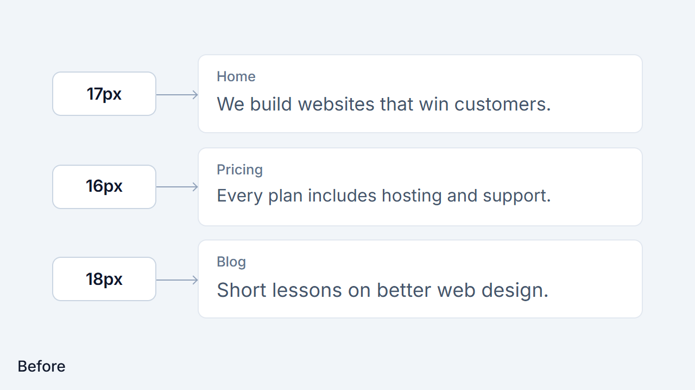

# Set type sizes as tokens

When font sizes are chosen by eye on each page, they slowly drift apart: one page sets body text at 17px, another at 16px and a third at 18px for the same kind of paragraph. Each choice seemed fine at the time, but together they make the site feel less put together. Define a set of type tokens (named font sizes) and use only those, so headings, labels and body text stay in one family of sizes, and changing a token once updates every place that uses it.

## Rule

Set every font size from a small set of type tokens, never from a value picked by eye. If you want separate names for headings and body copy, make them semantic tokens that point to the same core set.

## How to apply

1. Search the styles for `font-size` declarations and list the distinct values. Look for near-duplicates like 16, 17 and 18px used for the same kind of text.
2. Define a small core scale as tokens in one place, usually CSS custom properties on `:root`: for example `text-sm`, `text-md`, `text-xl` and `text-3xl`.
3. Give each kind of text one token: body paragraphs `body-md` (a semantic token set to `text-md`), labels `text-sm`, subheadings `text-xl`, page headings `text-3xl`.
4. Replace the raw sizes with the tokens, folding near-duplicates into the nearest token.
5. For body copy and headings with their own names, add semantic tokens whose values are core tokens, like `--body-md: var(--text-md)` and `--heading-md: var(--text-xl)`.

```css
:root {
  /* Core type scale */
  --text-sm: 0.875rem;  /* 14px */
  --text-md: 1rem;      /* 16px */
  --text-xl: 1.25rem;   /* 20px */
  --text-3xl: 1.875rem; /* 30px */

  /* Semantic tokens, built from the core scale */
  --body-md: var(--text-md);
  --heading-md: var(--text-xl);
}

p { font-size: var(--body-md); }
label, .caption { font-size: var(--text-sm); }
h3 { font-size: var(--heading-md); }
h1 { font-size: var(--text-3xl); }
```

## Check your work

- [ ] Every `font-size` uses a token; no raw px or rem values appear outside the token definitions.
- [ ] The same kind of text, like body paragraphs or card titles, uses the same token on every page.
- [ ] Changing `--body-md` once changes every paragraph on the site.
- [ ] Semantic tokens like `--body-md` and `--heading-md` point to a core token, not to a raw value.

## When to break it

- A size used exactly once, like an oversized number in one hero, can stay a plain value.
- Fluid sizes still belong in tokens: store the `clamp()` expression as the token's value.

## Before and after

- **Before:** intro paragraphs on the Home, Pricing and Blog pages, each with its own size typed in: 17px, 16px and 18px.
- **After:** all three take their size from one `body-md` token, set to 16px.

| Before (`before.png`) | After (`after.png`) |
| --- | --- |
|  |  |

## Files

- `before.png` and `after.png`: screenshots of the two states, **Before** and **After**.
- `demo.html`: a self-contained page that shows the lesson working. Open it in a browser.
- `lesson.md`: the lesson as written on designspo.co, word for word.
