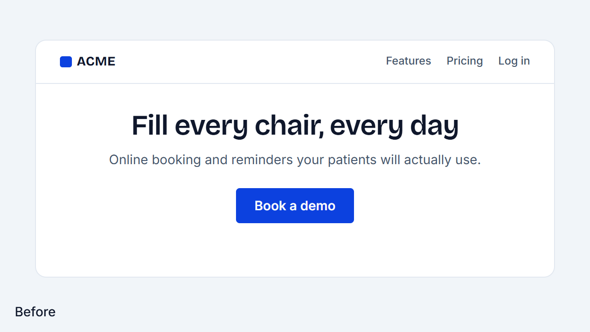
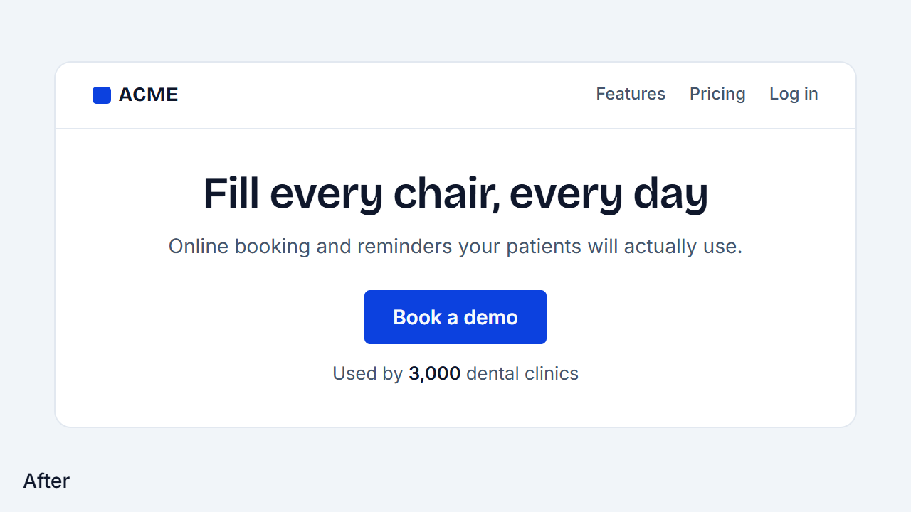

# Showing who uses your product already

Building trust close to calls to action is one of the most effective ways to raise conversions on a marketing site. A short line like "Used by 3,000 dental clinics" or "Trusted by 50+ startups in SF" is one of the fastest forms of social proof: it's evidence that other people already trust you, it fits right under a headline or button, and readers take it in at a glance.

## Rule

Right under the main headline or call-to-action button, add one line that says how many customers already use the product and who they are. Use a number that's large for the market and specific to the audience, and keep it up to date.

## How to apply

1. Get the real, current count from the site owner or existing copy. Never estimate or invent it.
2. Name who the number counts, in the visitor's terms: "dental clinics", "startups in SF", "Venture Capital funds".
3. Prefer the number that means most to the target market. "100 Venture Capital funds" can say more to the right visitor than "10,000 investors", because it shows that high-signal people already trust you.
4. Place it as one line of small text directly under the hero button or headline, and pick out the number with a heavier weight.
5. Keep the number in one place, like a shared component or a site setting, so it's easy to update as it grows. An old number undersells you.

```html
<a class="button" href="/demo">Book a demo</a>
<p class="proof">Used by <strong>3,000</strong> dental clinics</p>
```

```css
.proof {
  margin: 12px 0 0;
  font-size: 0.875rem;
  color: #45556c; /* muted, but at least 4.5:1 contrast on white */
}

.proof strong {
  font-weight: 600;
  color: #0f172b;
}
```

## Check your work

- [ ] One line under the hero headline or button says how many customers use the product.
- [ ] It names the audience, not just "users" or "customers".
- [ ] The number is real and current, and lives in one place that's easy to update.
- [ ] It stays on one line on a phone-width screen and doesn't compete with the button.

## When to break it

- If the number is still small for the market, leave the count out for now and use a specific testimonial or a well-known customer instead.
- One proof line per button is enough: stacking several makes each one easier to skip.

## Before and after

- **Before:** the top of a website for dental booking software, a nav and a hero reading "Fill every chair, every day", with a Book a demo button and nothing under it.
- **After:** one line under the button reads "Used by 3,000 dental clinics", with the number in bold.

| Before (`before.png`) | After (`after.png`) |
| --- | --- |
|  |  |

## Files

- `before.png` and `after.png`: screenshots of the two states, **Before** and **After**.
- `demo.html`: a self-contained page that shows the lesson working. Open it in a browser.
- `lesson.md`: the lesson as written on designspo.co, word for word.
