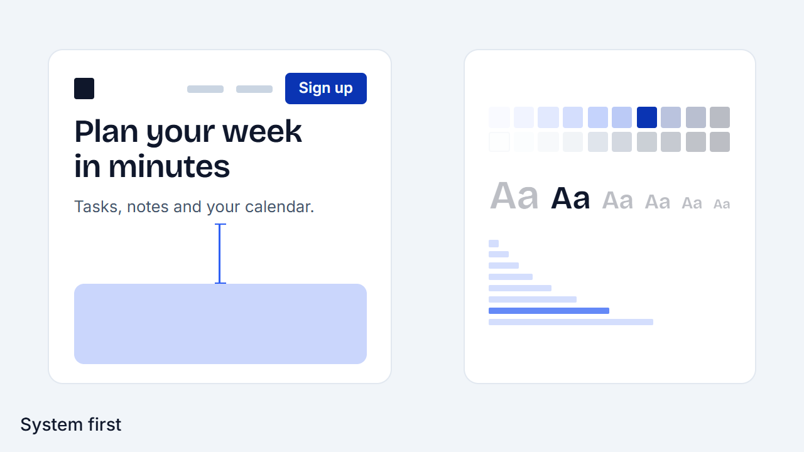

# Start your system from a real page

It's tempting to design a complete system before building any pages, with every color shade, font size and spacing step decided up front. The risk is that many of those tokens never get used, while the ones you actually need turn out to be missing. Building one real page first, often the homepage, and pulling its values into tokens gives a smaller system that grows from real needs and actually gets used.

## Rule

Don't define a full token scale before any page exists. Build one real page, turn the colors, sizes and spacing it uses into tokens, and add a token only when a page needs a value the system doesn't have yet.

## How to apply

1. Build one real page first, usually the homepage, with real content.
2. List the values it uses: colors (buttons, text, backgrounds), font sizes, and the spacing between elements and sections.
3. Merge near-duplicates (like 46px and 48px gaps) into one value, then define each as a token named by its role or scale step.
4. Replace the raw values on the page with the tokens.
5. For each new page, reuse the existing tokens first. When a page needs something the system doesn't have, add a token for it then.
6. Remove tokens that no page uses.

```css
/* Pulled from the homepage: only what it uses */
:root {
  --brand-600: #0A34B3;  /* Sign up button */
  --heading-l: 2.5rem;   /* hero heading */
  --space-48: 3rem;      /* gap above the hero image */
}

.button { background: var(--brand-600); }
h1 { font-size: var(--heading-l); }
.hero__image { margin-top: var(--space-48); }
```

## Check your work

- [ ] Every token is used on at least one page.
- [ ] No page uses a raw color, font size or spacing value that should be a token.
- [ ] The token list grew from built pages, not from a scale filled in ahead of time.

## When to break it

- If an existing brand guide already fixes some values, like the logo colors, start with those, and still add the rest only as pages need them.

## Before and after

- **System first:** a homepage next to a full sheet of 20 color shades, 6 type sizes and 8 spacing steps decided up front. The page uses only three of them; the rest are faded.
- **Page first:** the same homepage, with the system shrunk to a small card holding only the tokens pulled from it: `brand-600` from the Sign up button, `heading-l` from the heading and `space-48` from the measured space between the intro line and the image, with an arrow from each element to its token.

| System first (`before.png`) | Page first (`after.png`) |
| --- | --- |
|  |  |

## Files

- `before.png` and `after.png`: screenshots of the two states, **System first** and **Page first**.
- `demo.html`: a self-contained page that shows the lesson working. Open it in a browser.
- `lesson.md`: the lesson as written on designspo.co, word for word.
