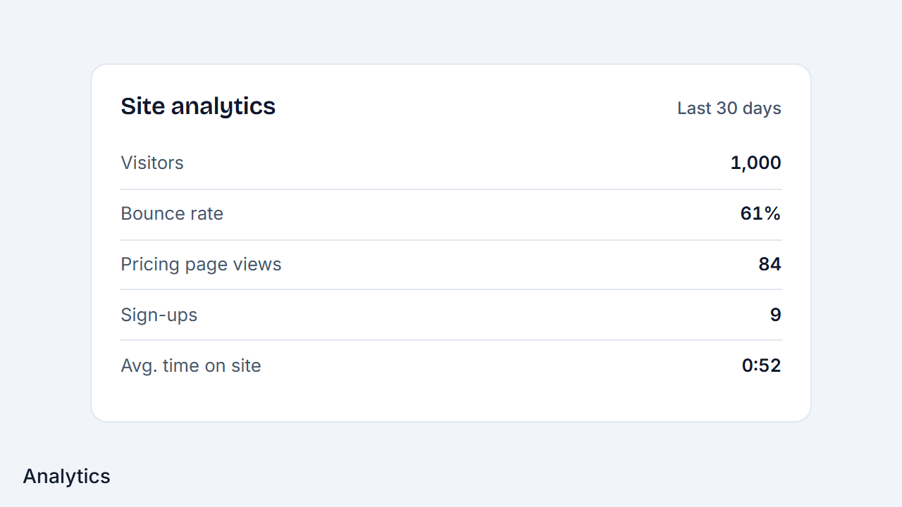
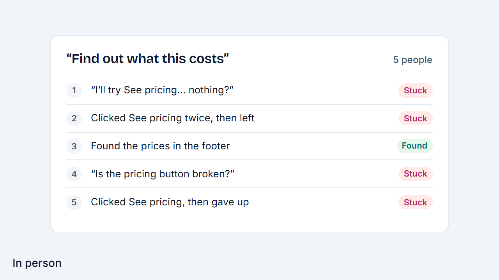

# Test your website with people in person

When a website launches, it's tempting to install analytics software and wait for a lot of data before improving the design. You don't need a large study to find most usability problems: research from the [Nielsen Norman Group](https://www.nngroup.com/articles/why-you-only-need-to-test-with-5-users/) suggests that testing with about five people can often uncover most of a page's biggest problems, since people tend to stumble over the same things. Where they get stuck is very likely where your visitors get stuck too.

## Rule

Don't wait for analytics to show what's wrong. Watch about five people try a simple task on the site without helping them, ask them to think out loud, fix the spots where they get stuck, then test again with a few new people.

## How to apply

1. Pick one simple task that matters, like "find out what this costs" or "book a call".
2. Find about five people who haven't seen the site, ideally people like your visitors.
3. Give each person the task, then watch them try it without helping or hinting.
4. Ask them to think out loud as they go, so you can hear what they expect to happen.
5. Note every spot where they hesitate, go the wrong way or get stuck, in their own words where you can.
6. Fix the spots that came up for more than one person.
7. Test the fixes with a few new people.

```markdown
Task: Find out what this costs

| Person | What happened                        | Result |
| ------ | ------------------------------------ | ------ |
| 1      | "I'll try See pricing... nothing?"   | Stuck  |
| 2      | Clicked See pricing twice, then left | Stuck  |
| 3      | Found the prices in the footer       | Found  |
| 4      | "Is the pricing button broken?"      | Stuck  |
| 5      | Clicked See pricing, then gave up    | Stuck  |

Fix first: the See pricing button doesn't go anywhere.
```

## Check your work

- [ ] The test used one simple, specific task, given in plain words.
- [ ] About five people who hadn't seen the site took part, one at a time.
- [ ] Nobody was helped during the task, and each person thought out loud.
- [ ] Every spot where more than one person got stuck has a fix.
- [ ] The fixes were tested again with a few new people.

## When to break it

- Five people find most of a page's biggest problems, not every problem. Run several small rounds, fixing between them, rather than one big study.
- If the site serves very different groups, like buyers and sellers, test a few people from each group.

## Before and after

- **Analytics:** a month of site analytics: 1,000 visitors, a 61% bounce rate, 84 pricing page views, 9 sign-ups and 0:52 average time on the site. Numbers, but no sign of why.
- **In person:** notes from watching five people try to "find out what this costs". Four get stuck on a See pricing button that does nothing; one finds the prices in the footer.

| Analytics (`before.png`) | In person (`after.png`) |
| --- | --- |
|  |  |

## Files

- `before.png` and `after.png`: screenshots of the two states, **Analytics** and **In person**.
- `demo.html`: a self-contained page that shows the lesson working. Open it in a browser.
- `lesson.md`: the lesson as written on designspo.co, word for word.
