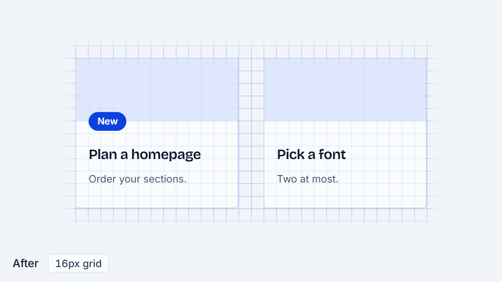

# Thinking in grids

A grid keeps everything in a design visually consistent. Laid over a layout, it shows at once when something is off balance, so you can correct it easily. Breaking the grid can be good too, since it gives a design character, but elements off the grid stand out, and if everything stands out, the design looks messy.

## Rule

Choose a base unit that divides easily (4, 8, 16 or 32px) and make every position, size and space a multiple of it. Let only a few elements break the grid, on purpose.

## How to apply

1. Choose the base unit: 4, 8, 16 or 32px. Avoid odd or less divisible numbers like 5 or 10, which leave fewer sizes to choose from.
2. Express spacing and sizing tokens as multiples of the unit.
3. Snap every edge to the grid: widths, heights, padding, margins and gaps.
4. Check the layout with a grid overlay (a layout grid in the design tool, or a temporary CSS background like the one below) and fix anything that falls between the lines.
5. Break the grid only where an element should stand out, like a badge that overlaps an image's edge.

```css
:root {
  --grid: 16px; /* the base unit */
}

.card {
  width: calc(18 * var(--grid));  /* 288px */
  padding: calc(2 * var(--grid)); /* 32px */
  gap: var(--grid);               /* 16px */
}

/* Temporary overlay to check alignment */
.show-grid {
  background-image:
    linear-gradient(to right, rgb(0 0 255 / 0.15) 1px, transparent 1px),
    linear-gradient(to bottom, rgb(0 0 255 / 0.15) 1px, transparent 1px);
  background-size: var(--grid) var(--grid);
}
```

## Check your work

- [ ] The base unit is 4, 8, 16 or 32px, not a number like 5 or 10.
- [ ] Every size, padding, margin and gap is a multiple of the base unit.
- [ ] With a grid overlay on a screenshot, element edges sit on grid lines.
- [ ] Only a few elements break the grid, and each one does it on purpose.

## When to break it

- For character: one deliberate break, like a badge or an image crossing a line, draws the eye. Keep breaks rare, because everything off the grid stands out.
- A grid can make a design look rigid, and it may not fit perfectly at every screen size. Where a fluid width can't land on the grid, let it flex and keep the spacing on the grid.

## Before and after

- **Before:** two lesson cards, each with an image, a title and a line of text, placed by eye on a 16px grid. Their edges fall between the lines, they have different widths, tops and image heights, the gap between them is off the grid, and their titles and text sit at different heights.
- **After:** both cards snap to the grid: the same width and height, side by side with a two-square gap, so their images, titles and text line up. Only the New badge on the first card, which straddles the image's bottom edge on purpose, breaks the grid.

| Before (`before.png`) | After (`after.png`) |
| --- | --- |
|  |  |

## Files

- `before.png` and `after.png`: screenshots of the two states, **Before** and **After**.
- `demo.html`: a self-contained page that shows the lesson working. Open it in a browser.
- `lesson.md`: the lesson as written on designspo.co, word for word.
