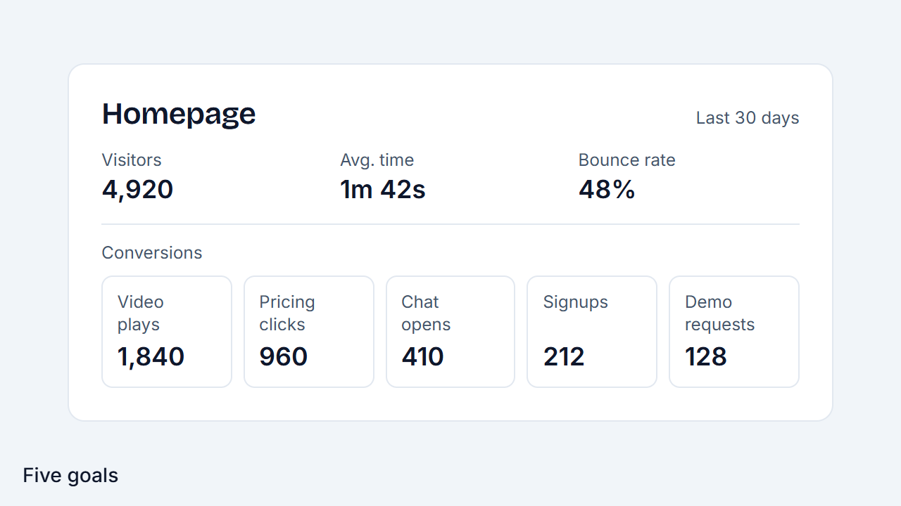
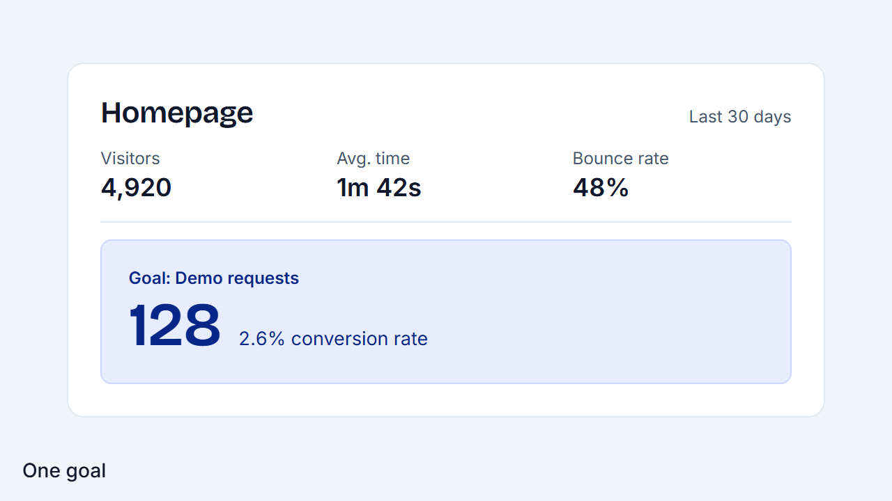

# Track one conversion goal per page

It's hard to improve something you don't measure. If you don't know how many people take the action you care about on a page, every design decision becomes a guess, and you can't tell whether a change helped or hurt. Give each key page one job, track that action as its conversion, and compare the number before and after each change. Tracking too many conversions makes the analytics harder to understand.

## Rule

For each key page, define exactly one conversion, the action that counts as success, and track it as an event or goal in the analytics tool. Keep other numbers, like visitors, time on page and bounce rate, as supporting data, not as extra conversions.

## How to apply

1. List the key pages: homepage, landing pages, pricing and product pages.
2. For each one, write down the single action that counts as success, like a demo request on the homepage or a signup on a landing page.
3. Send one event when that action completes (on a successful form submission or the confirmation page, not on a button click alone), and mark it as the conversion or key event in the analytics tool.
4. Unmark other events counted as conversions for that page. Keep them as ordinary events if they're useful.
5. Note the conversion rate before each design change, then compare it over a similar period afterwards.

```js
// Send this once the demo request form has been submitted successfully.
// Google Analytics 4 (gtag.js): then mark demo_request as a key event in GA4.
gtag('event', 'demo_request');

// Plausible: add "Demo request" as a custom event goal.
plausible('Demo request');
```

## Check your work

- [ ] Each key page has exactly one conversion, written down with its event name.
- [ ] The event fires only when the action actually completes.
- [ ] Only that event is marked as the page's conversion in the analytics tool.
- [ ] Visitors, time on page and bounce rate are still collected as context.
- [ ] There's a baseline conversion rate to compare the next change against.

## When to break it

- Pages without a job of their own, like legal pages or a 404 page, don't need a conversion.
- Smaller steps toward the goal, like watching a demo video, can still be tracked as ordinary events, as long as only one action counts as the page's success.

## Before and after

- **Five goals:** a homepage report with five conversion counters of equal weight (video plays, pricing clicks, chat opens, signups and demo requests), so it's unclear which number shows success.
- **One goal:** the same report with a single goal, demo requests: 128 in the last 30 days, a 2.6% conversion rate. Visitors, average time and bounce rate stay as context.

| Five goals (`before.png`) | One goal (`after.png`) |
| --- | --- |
|  |  |

## Files

- `before.png` and `after.png`: screenshots of the two states, **Five goals** and **One goal**.
- `demo.html`: a self-contained page that shows the lesson working. Open it in a browser.
- `lesson.md`: the lesson as written on designspo.co, word for word.
