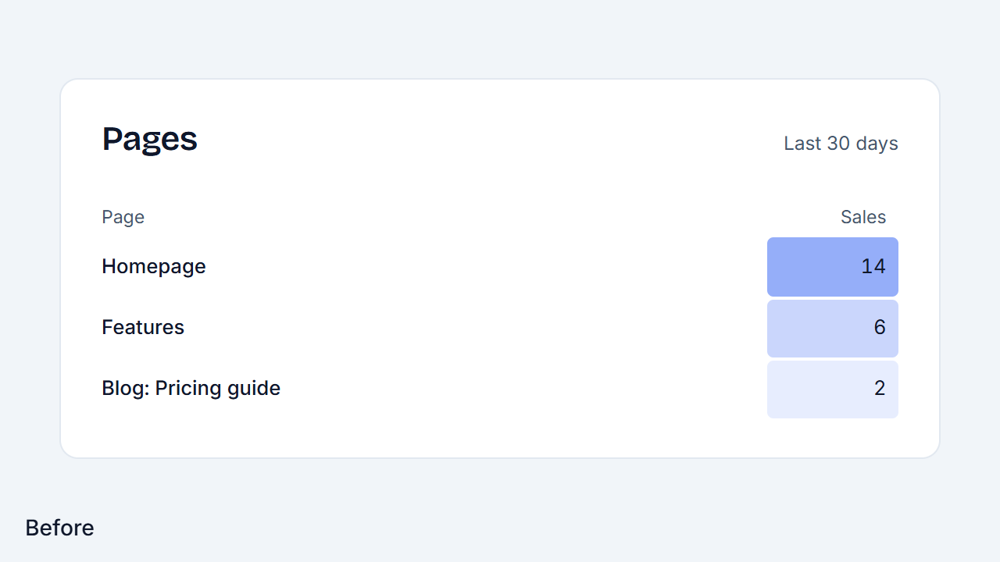
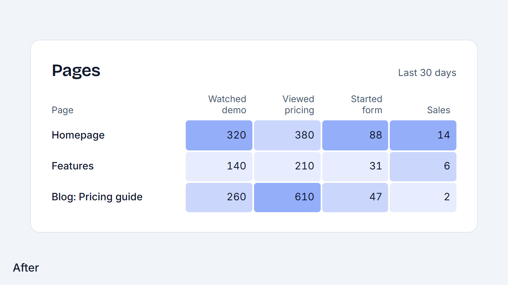

# Track the in-between steps

Most visitors won't buy or sign up on their first visit. They come back several times, look around and compare options before they decide, so if you only track the final sale or signup, you can't really tell how the site is performing. Smaller actions that show interest, often called micro-conversions, show which pages move people closer to deciding, even when final sales are low.

## Rule

Alongside the final sale or signup, track the small actions that show interest, like watching a demo video, visiting the pricing page and starting a form, and report them for each page.

## How to apply

1. Keep the final conversion (a sale, signup or booked demo) as the main goal.
2. List the actions that show interest on the way, like playing the demo video, viewing the pricing page and starting a form.
3. Send an event for each: when the video starts playing, when the pricing page loads, and on the first interaction with a form.
4. Build a report by page that shows each micro-conversion next to the final conversion.
5. Judge pages, especially blog posts, on both. A post that sends many readers to the pricing page may be doing more work than its direct sales suggest.

```js
// Google Analytics 4 (gtag.js). Use your analytics tool's equivalent.
document.querySelector('video.demo')?.addEventListener('play', () => {
  gtag('event', 'watched_demo');
}, { once: true });

document.querySelectorAll('form').forEach((form) => {
  form.addEventListener('focusin', () => gtag('event', 'started_form'), { once: true });
});

// On the pricing page only
gtag('event', 'viewed_pricing');
```

## Check your work

- [ ] Each micro-conversion is sent once per page view, not on every click or keystroke.
- [ ] The final conversion is still tracked and is still the main goal.
- [ ] A report shows the micro-conversions for each page next to its final conversions.
- [ ] Blog posts and other content pages are judged on micro-conversions too, not only on direct sales.

## When to break it

- Don't track every click: pick a few actions that really show interest in buying.
- When people usually decide in one visit, like with low-priced impulse buys, the final sale may be enough.

## Before and after

- **Before:** a pages report that only tracks sales: 14 from the homepage, 6 from the features page and 2 from a blog post called "Pricing guide", which looks like it does the least.
- **After:** the same report also tracks watched demo, viewed pricing and started form, and the blog post sends the most people to the pricing page: 610, more than the homepage.

| Before (`before.png`) | After (`after.png`) |
| --- | --- |
|  |  |

## Files

- `before.png` and `after.png`: screenshots of the two states, **Before** and **After**.
- `demo.html`: a self-contained page that shows the lesson working. Open it in a browser.
- `lesson.md`: the lesson as written on designspo.co, word for word.
