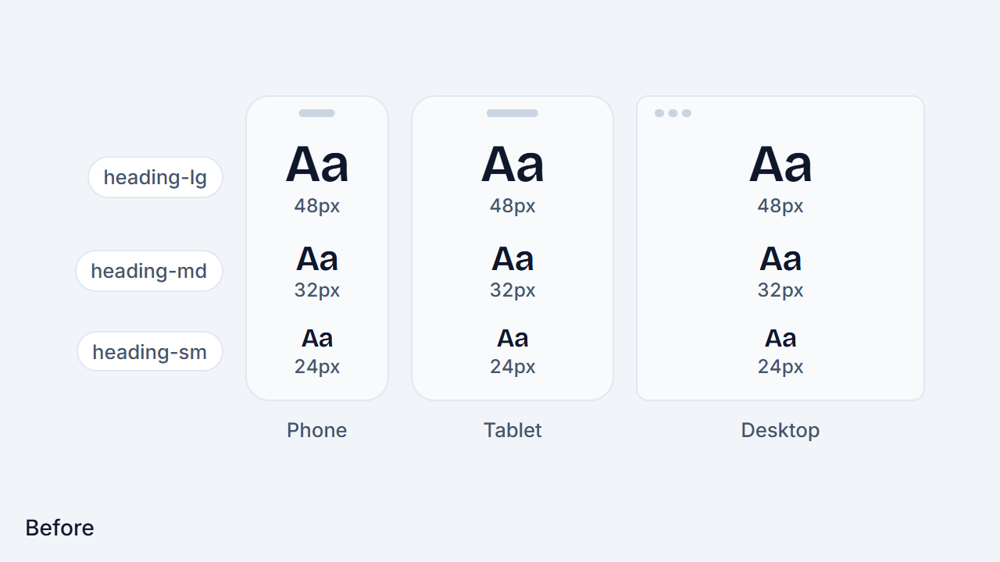
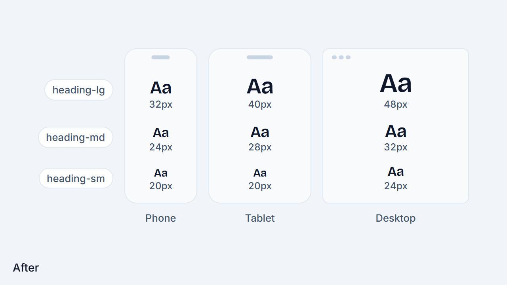

# Two-Dimensional Scales

Sizing systems attach semantic names (small, medium, large) to primitive values (4px, 12px, 16px), but nothing says a name can only have one value. Most headlines, for example, should be much smaller on mobile than on desktop. In a two-dimensional scale, one dimension is the semantic name and the other is the set of primitive values that name takes across screen sizes: a line of names becomes a rectangle of values.

## Rule

Give each semantic size token a value at each breakpoint, taken from the primitive scale, and change the token's value at the breakpoint rather than overriding sizes inside components.

## How to apply

1. List the breakpoints you design for, for example phones below 768px, tablets and desktops.
2. Fill in the table: for each semantic token, choose a primitive value per breakpoint. Keep every value divisible by 4px so the layout stays clean at every size.
3. Set the smallest screen's values on `:root`, then reassign the same tokens in a media query for each larger breakpoint.
4. Use only the semantic tokens in components, so they need no media queries of their own for these sizes.

```css
:root {
  --heading-lg: 2rem;     /* 32px on phones */
  --heading-md: 1.5rem;   /* 24px */
  --heading-sm: 1.25rem;  /* 20px */
}

@media (min-width: 768px) {
  :root {
    --heading-lg: 2.5rem;  /* 40px on tablets */
    --heading-md: 1.75rem; /* 28px */
  }
}

@media (min-width: 1024px) {
  :root {
    --heading-lg: 3rem;    /* 48px on desktops */
    --heading-md: 2rem;    /* 32px */
    --heading-sm: 1.5rem;  /* 24px */
  }
}

h1 { font-size: var(--heading-lg); }
h2 { font-size: var(--heading-md); }
h3 { font-size: var(--heading-sm); }
```

## Check your work

- [ ] Every semantic size token has a value at every breakpoint, and each value comes from the primitive scale.
- [ ] Every value is divisible by 4px.
- [ ] Components use the semantic tokens and have no media-query overrides for these sizes.
- [ ] Headlines are smaller on a phone than on a desktop.

## When to break it

- Larger projects: a responsive scale, where each size is calculated from the viewport width (with clamp(), for example), keeps proportions the same on every screen and is easier to maintain. The cost is fractional sizes, like a 65.3px headline instead of 64px.
- If sizes between breakpoints look too large or too small, remember a two-dimensional scale only designs for a few of the thousands of screen sizes. That's the case for going responsive.

## Before and after

- **Before:** heading-lg, heading-md and heading-sm each have one value on every screen (48, 32 and 24px), so the phone gets desktop-sized headings.
- **After:** each token has a value per screen. On phone, tablet and desktop, heading-lg is 32, 40 and 48px, heading-md 24, 28 and 32px, and heading-sm 20, 20 and 24px.

| Before (`before.png`) | After (`after.png`) |
| --- | --- |
|  |  |

## Files

- `before.png` and `after.png`: screenshots of the two states, **Before** and **After**.
- `demo.html`: a self-contained page that shows the lesson working. Open it in a browser.
- `lesson.md`: the lesson as written on designspo.co, word for word.
