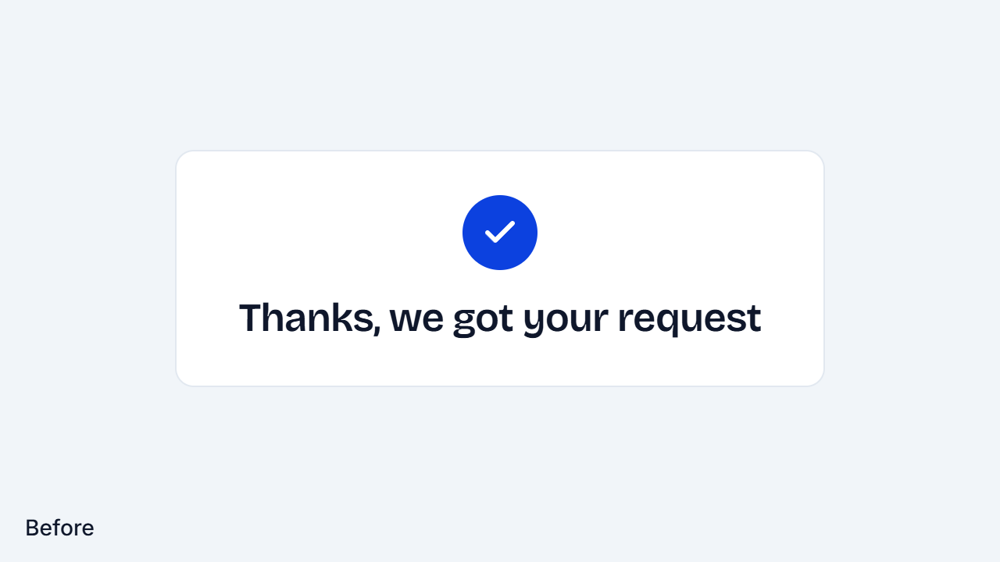
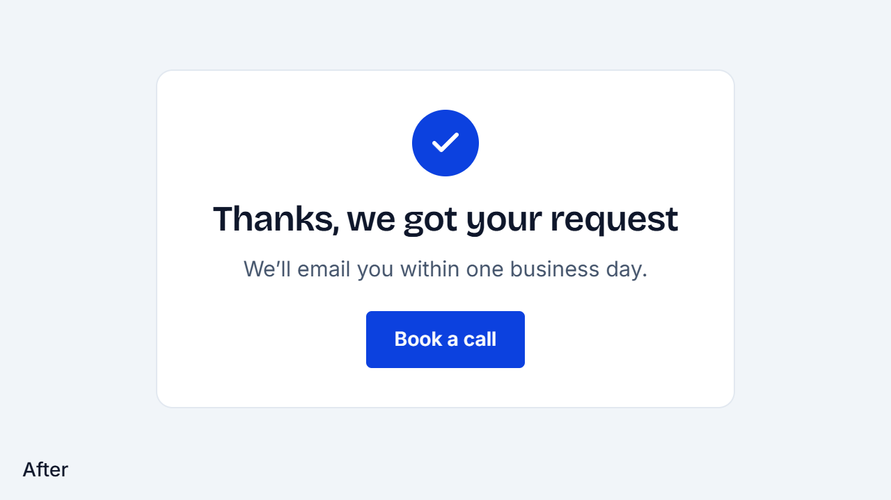

# Use the thank-you page for the next step

Someone who has just submitted a form is paying close attention to whatever comes next, so the thank-you page is one of the few pages almost everyone looks at carefully. Yet many sites show a plain "Thanks!" or "Order Confirmed." and stop there. Use that moment to build a stronger relationship: confirm what happens next, then make one related next step easy to take.

## Rule

On every thank-you or confirmation page, first say what happens next and when, then offer exactly one related next step as a single button or link.

## How to apply

1. Find every page or message shown after a form is submitted: contact, quote, demo, signup, newsletter and order confirmations.
2. Under the thank-you heading, add one sentence that confirms what happens next and when, like "We'll email you within one business day." Make sure it's true.
3. Add one related next step that fits what the person just did, like booking a call after a contact form or reading a short case study after a quote request.
4. Show it as one button or link. Don't add a list of links, social icons or several options: a long list pulls attention in different directions.

```html
<main class="thanks">
  <h1>Thanks, we got your request</h1>
  <p>We'll email you within one business day.</p>
  <a class="button" href="/book-a-call">Book a call</a>
</main>
```

```css
.thanks {
  display: grid;
  justify-items: center;
  gap: 1rem;
  text-align: center;
}
```

## Check your work

- [ ] Each thank-you page says what happens next and roughly when.
- [ ] Each one offers exactly one next step, as a single button or link to a real page.
- [ ] The next step relates to the form that was just submitted.
- [ ] No list of links competes with that one step.

## When to break it

- If the form finished the whole job, like a password reset, the confirmation alone is enough.
- Order confirmations still need the details people expect, like the order number and delivery date; add the one next step after them.

## Before and after

- **Before:** a thank-you card with a check mark and the heading "Thanks, we got your request", and nothing underneath.
- **After:** the card grows and pushes the heading up to make room for "We'll email you within one business day." and a single "Book a call" button.

| Before (`before.png`) | After (`after.png`) |
| --- | --- |
|  |  |

## Files

- `before.png` and `after.png`: screenshots of the two states, **Before** and **After**.
- `demo.html`: a self-contained page that shows the lesson working. Open it in a browser.
- `lesson.md`: the lesson as written on designspo.co, word for word.
