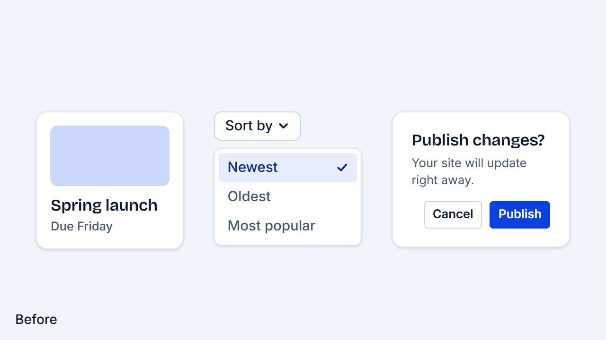

# Use three shadow levels

Shadows show how high an element sits above the page: a card resting on the page needs only a faint shadow, while a modal (a popup that floats over everything) needs a much stronger one. When shadows are picked by eye each time, the same kind of element ends up at different heights on different pages, and sometimes a card looks higher than a modal. Most sites can get by with three shadow levels, defined once as tokens.

## Rule

Use three shadow tokens and pick them by the element's height: `--shadow-sm` for cards, `--shadow-md` for dropdowns and menus, `--shadow-lg` for modals. Don't write `box-shadow` values by eye in components.

## How to apply

1. Search the styles for `box-shadow` and list the distinct values and where they're used.
2. Sort the elements by height: resting on the page (cards), floating above it (dropdowns, menus, popovers), and over everything (modals and dialogs).
3. Define three tokens in one place, usually CSS custom properties on `:root`, growing in offset, blur and opacity from small to large.
4. Tint the shadows with a dark shade of your brand color instead of pure black: use its RGB values with a low alpha. It often looks more natural.
5. Replace every elevation shadow with the token for the element's level.

```css
:root {
  /* Tinted with a dark brand blue (#020D2C) instead of pure black */
  --shadow-sm: 0 1px 2px rgb(2 13 44 / 0.06), 0 1px 3px rgb(2 13 44 / 0.1);
  --shadow-md: 0 4px 6px -2px rgb(2 13 44 / 0.08), 0 12px 20px -4px rgb(2 13 44 / 0.16);
  --shadow-lg: 0 16px 32px -8px rgb(2 13 44 / 0.22), 0 36px 72px -16px rgb(2 13 44 / 0.36);
}

.card { box-shadow: var(--shadow-sm); }
.dropdown-menu, .popover { box-shadow: var(--shadow-md); }
.modal { box-shadow: var(--shadow-lg); }
```

## Check your work

- [ ] Every elevation `box-shadow` uses one of the three tokens; no hand-written shadow values remain in components.
- [ ] Cards use the smallest shadow, dropdowns and menus the medium one and modals the largest: nothing that sits lower has a stronger shadow than something above it.
- [ ] Elements of the same kind have the same shadow on every page.
- [ ] The shadow color is a dark shade of the brand color, not pure black.

## When to break it

- Inset shadows, focus rings and decorative glows aren't elevation, so they don't need to fit the three levels.
- An interface with more layers, like toasts over modals, may need a fourth level. Add it as a token, not as a one-off value.

## Before and after

- **Before:** a project card, a Sort by dropdown menu and a Publish changes dialog, all with the same light shadow, so the dialog looks no higher than the card.
- **After:** three shadow levels from left to right, each labelled: Level 1 (`--shadow-sm`, subtle) on the card, Level 2 (`--shadow-md`, medium) on the menu and Level 3 (`--shadow-lg`, strong) on the dialog, all tinted with a dark brand blue.

| Before (`before.png`) | After (`after.png`) |
| --- | --- |
|  |  |

## Files

- `before.png` and `after.png`: screenshots of the two states, **Before** and **After**.
- `demo.html`: a self-contained page that shows the lesson working. Open it in a browser.
- `lesson.md`: the lesson as written on designspo.co, word for word.
