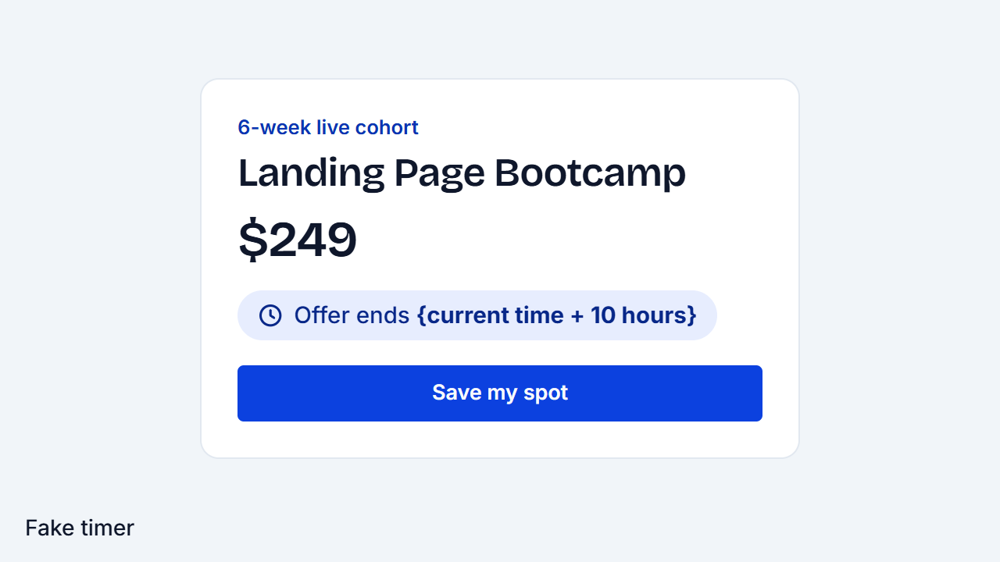
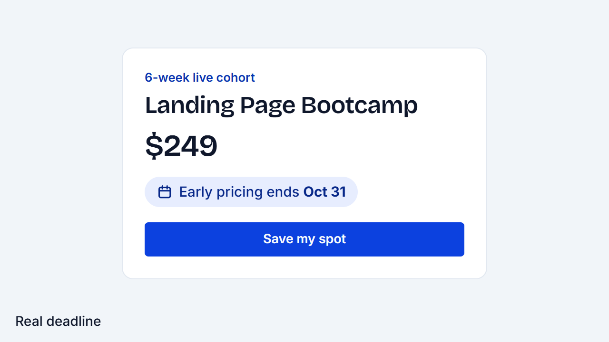

# Use urgency only when it’s real

Urgency can push people to act. A countdown timer or a label that says "only 2 left" gives people a reason to decide now, and that can lift conversions. But it has to be real: if a deadline resets every time the page reloads, visitors who notice may stop believing the site's other claims too. A specific, true deadline, like "Early pricing ends Oct 31", gives people a real reason to act without tricking them.

## Rule

Only show urgency for a real limit, and state it as a specific, true claim: what ends and when, or how many are actually left. Never show a countdown or a stock count that resets or is made up.

## How to apply

1. Find every urgency element: countdown timers, "offer ends" banners, "only X left" labels, "selling fast" badges.
2. For each one, confirm the real limit behind it with the site owner: an event date, a price increase, a group program with a fixed number of places.
3. Replace evergreen or per-visitor countdowns with the real date and what happens then, like "Early pricing ends Oct 31".
4. Drive any countdown or count from real data, a fixed end date or the actual number of places left, so it's the same for every visitor and on every reload.
5. Remove the element once the limit has passed, or if there's no real limit behind it.

```html
<p class="deadline">Early pricing ends <time datetime="2026-10-31">Oct 31</time></p>
```

```js
// A countdown counts to one fixed moment, the same for everyone. Never start it on page load.
const deadline = new Date('2026-10-31T23:59:59Z');
const msLeft = deadline - Date.now();
```

## Check your work

- [ ] Every urgency claim matches a real limit the business can point to.
- [ ] Reloading the page, or opening it in a private window, shows the same deadline or count.
- [ ] Deadlines name a specific date, and expired offers are gone from the page.
- [ ] No timer starts counting from the moment a visitor arrives.

## When to break it

- A live countdown is fine when it counts to a real moment that's the same for everyone, like a webinar start or the end of a sale: the rule is against fake limits, not timers.

## Before and after

- **Fake timer:** an offer card for a six-week course at $249, with a deadline that reads "Offer ends {current time + 10 hours}": it's worked out from each visitor's own clock, so it moves with every visit.
- **Real deadline:** the same spot reads "Early pricing ends Oct 31".

| Fake timer (`before.png`) | Real deadline (`after.png`) |
| --- | --- |
|  |  |

## Files

- `before.png` and `after.png`: screenshots of the two states, **Fake timer** and **Real deadline**.
- `demo.html`: a self-contained page that shows the lesson working. Open it in a browser.
- `lesson.md`: the lesson as written on designspo.co, word for word.
