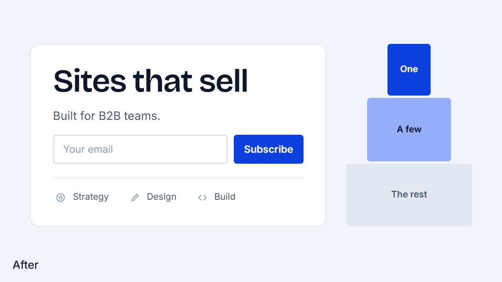

# Visual hierarchy is like a pyramid

Hierarchy works like a pyramid: the more an element stands out, the fewer of them there can be. If everything stands out, visitors don't know what to focus on, and if nothing does, they don't either. One element at the top stands out, a few below it get noticed, and everything else forms a quiet base that blends in and gives the design cohesion.

## Rule

In every section, make exactly one element stand out, let a few get noticed, and style everything else to blend in, consistently with each other.

## How to apply

1. For each section, choose the one element that should stand out, like a headline, a graphic, a video or an animation. Give it the largest size or the strongest contrast.
2. Choose a few elements that should get noticed, like a subtitle, a form, a statistic or a supporting graphic. Make them clearly visible but quieter than the top element.
3. Style everything else (icons, paragraphs, borders, menu items) to blend in: smaller, lighter and muted, and all in the same style, since parts that look totally different from one another make a design feel messy.
4. Remove emphasis that competes from the base: bold or uppercase menu items, brightly colored icons, heavy borders, extra accent colors.

```css
/* Stands out: one element per section */
.hero h1 { font-size: 3rem; font-weight: 700; color: #0f172b; }

/* Gets noticed: a few elements */
.hero .subtitle { font-size: 1.125rem; color: #45556c; }
.hero .button { background: #0c41df; color: #fff; } /* the only accent */

/* Blends in: everything else, in one shared style */
.nav a,
.features li {
  font-size: 0.875rem;
  font-weight: 400;
  text-transform: none;
  color: #45556c;
}
.features svg { color: #90a1b9; }
.features { border-top: 1px solid #e2e8f0; }
```

## Check your work

- [ ] Each section has exactly one element that is clearly the largest or highest in contrast.
- [ ] Only a few elements use secondary emphasis, like the one filled button and a medium-size subtitle.
- [ ] Menu items, icons, paragraphs and borders share one quiet style, with no bold, uppercase or bright colors among them.
- [ ] Blur or squint at a screenshot: the eye lands on the top element first.

## When to break it

- Each section has its own pyramid, but the page has one too: a section's top element should still be quieter than the page's main headline.
- An error or alert can briefly take the top spot, because it needs attention right away.

## Before and after

- **Before:** a hero with the headline "Sites that sell" beside a three-tier pyramid (One, A few, The rest). Everything has a similar weight: the headline is barely bigger than a bold blue subtitle, a thick-bordered email field, a yellow uppercase Subscribe button, a heavy blue divider and red, green and yellow icons, and the pyramid is a solid blue column, every tier as big as the others.
- **After:** the headline grows and is the one thing that stands out; the subtitle and the email form with its blue button are noticeable; the divider and icons blend in. The tiers narrow into a pyramid, each level with the row it describes.

| Before (`before.png`) | After (`after.png`) |
| --- | --- |
|  |  |

## Files

- `before.png` and `after.png`: screenshots of the two states, **Before** and **After**.
- `demo.html`: a self-contained page that shows the lesson working. Open it in a browser.
- `lesson.md`: the lesson as written on designspo.co, word for word.
