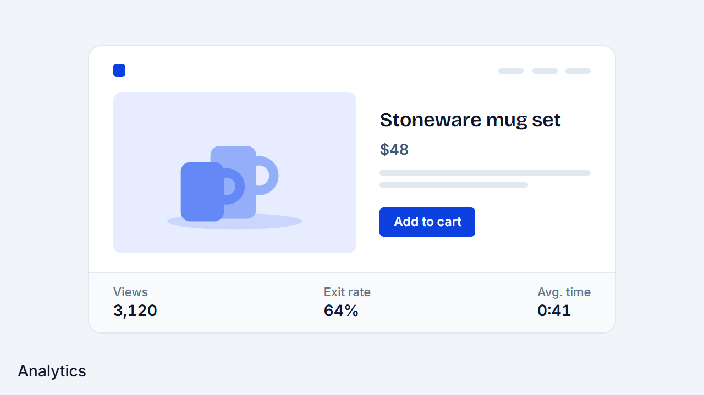
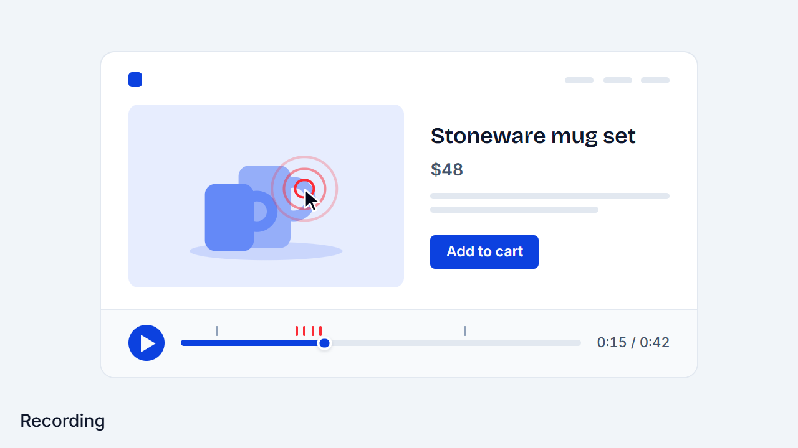

# Watch session recordings to find confusion

Analytics can tell you where people leave a page, but not always why. Session recordings replay what visitors actually do on the page, like where they scrolled and what they clicked, so you can see the page through their eyes. They often point straight to what needs fixing: if many people keep clicking an image that doesn't go anywhere, they probably expect it to.

## Rule

Before changing a key page because of its analytics, watch 10 to 20 session recordings of it. Note where visitors hesitate, scroll back up or click things that aren't links, and fix the spots that come up again and again.

## How to apply

1. Add a session recording tool to the site. Free tools like [Microsoft Clarity](https://clarity.microsoft.com) can record sessions for you. Mask form fields and personal data.
2. Pick a key page, like the homepage, a product page or the pricing page, and filter the recordings to it.
3. Watch 10 to 20 recordings. Note each moment a visitor:
   - hesitates, with the cursor stopped or wandering;
   - scrolls back up to look for something;
   - clicks something that isn't a link or button, or clicks the same spot again and again.
4. Group the notes by element. Anything several visitors do is a pattern.
5. Fix each pattern the way visitors expect: if they keep clicking a product photo, make it open a larger view; if they click text that looks like a link, make it a link or restyle it.

```html
<!-- Before: visitors keep clicking a photo that does nothing -->


<!-- After: the photo does what they expect and opens the full-size image -->
<a class="product-photo" href="/mugs-large.jpg">
  
</a>
```

## Check your work

- [ ] Session recording runs on the key pages, with form fields and personal data masked.
- [ ] At least 10 recordings of the page were watched, not just its summary numbers.
- [ ] The notes list each spot where visitors hesitated, scrolled back up or clicked something that isn't a link, with how many did it.
- [ ] Every element several visitors clicked now does what they expected, or no longer looks clickable.

## When to break it

- One visitor's odd behaviour isn't a pattern. Fix what comes up again and again, not what happened once.
- Not every click is confusion: people also click text to select or copy it. Watch what they do next before changing anything.

## Before and after

- **Analytics:** a product page for a stoneware mug set with its numbers: 3,120 views, a 64% exit rate and 0:41 average time. They show that people leave, not why.
- **Recording:** a session recording of the same page. The visitor's cursor clicks the product photo, which isn't a link, again and again, and the burst of clicks shows in red on the player's timeline.

| Analytics (`before.png`) | Recording (`after.png`) |
| --- | --- |
|  |  |

## Files

- `before.png` and `after.png`: screenshots of the two states, **Analytics** and **Recording**.
- `demo.html`: a self-contained page that shows the lesson working. Open it in a browser.
- `lesson.md`: the lesson as written on designspo.co, word for word.
